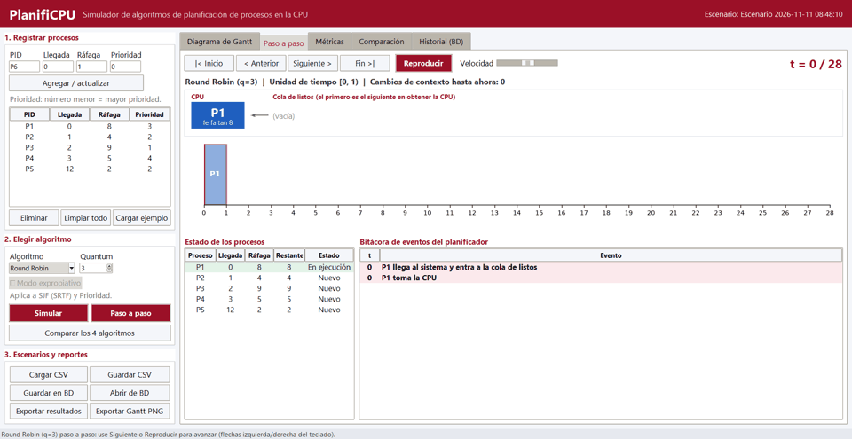
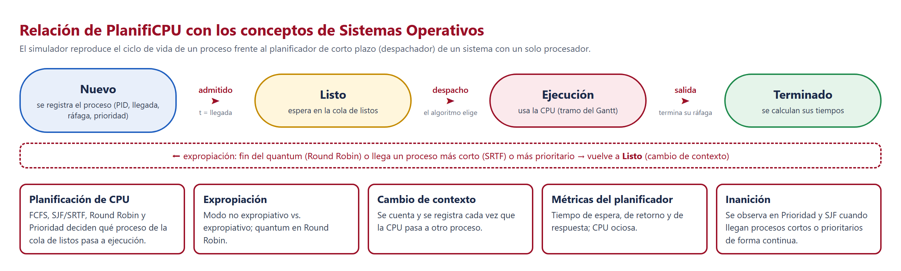
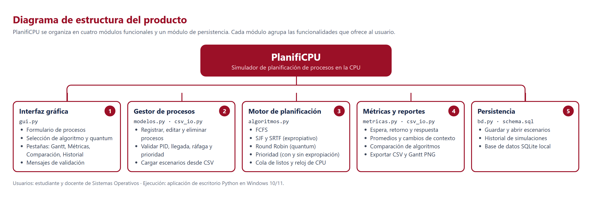
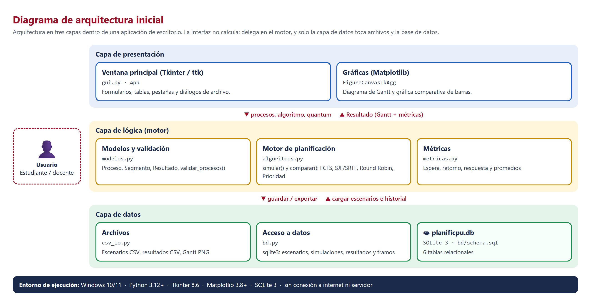
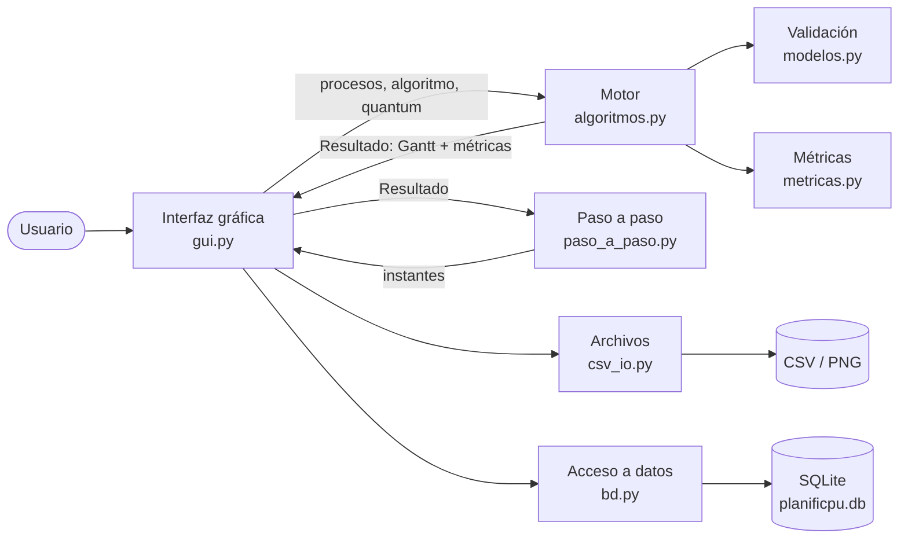
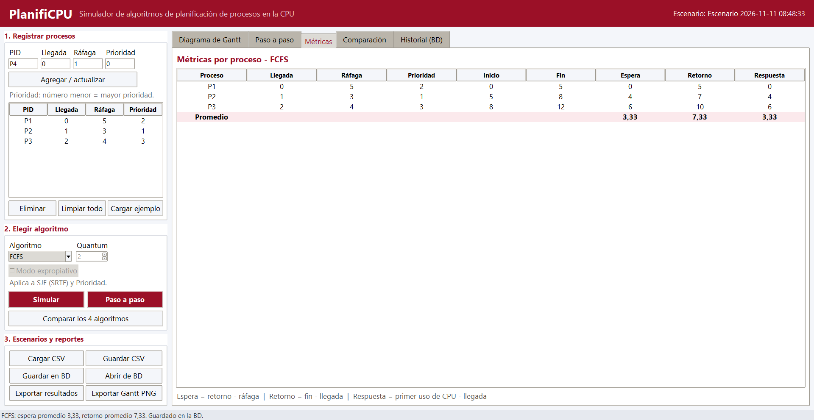
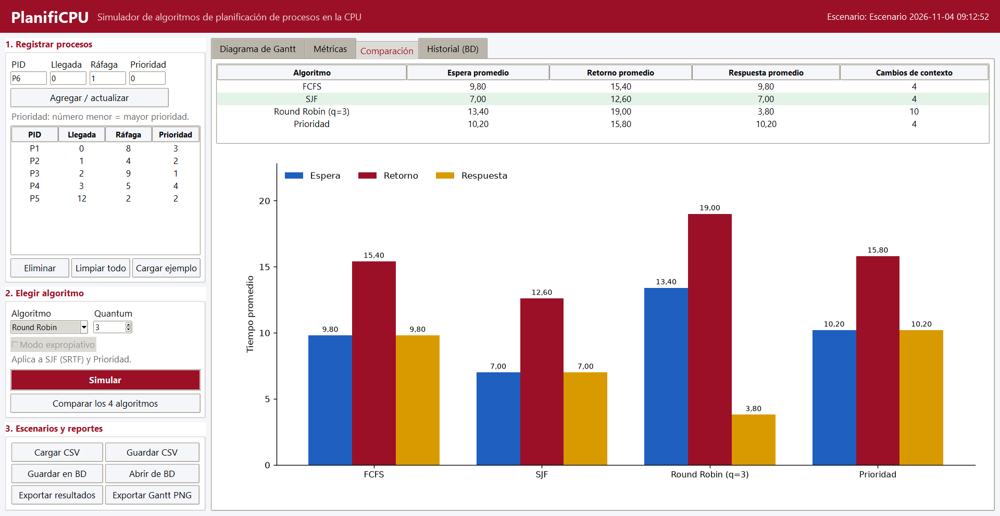
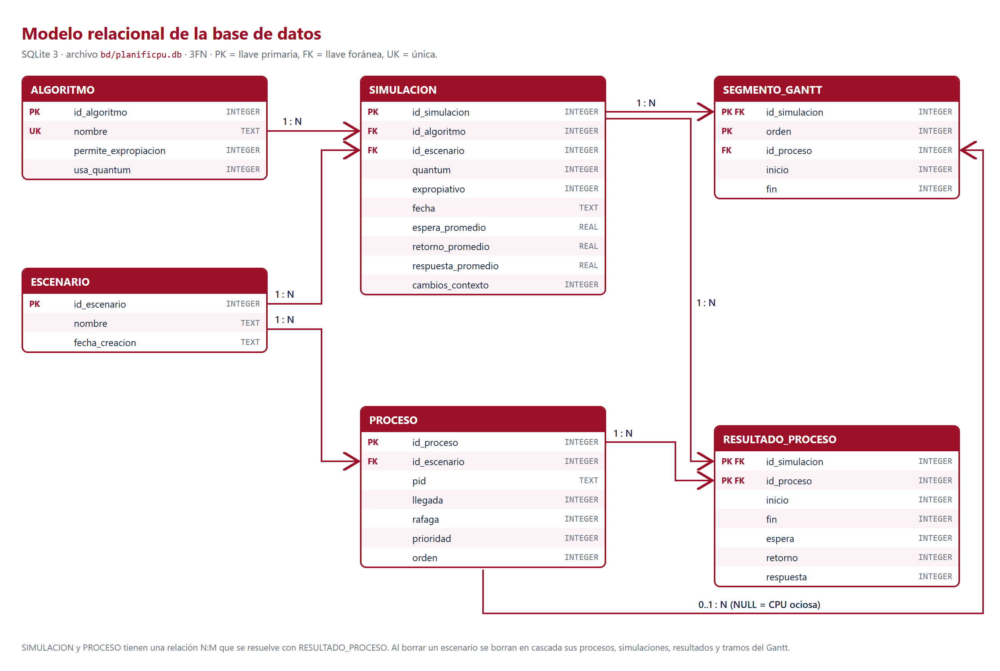
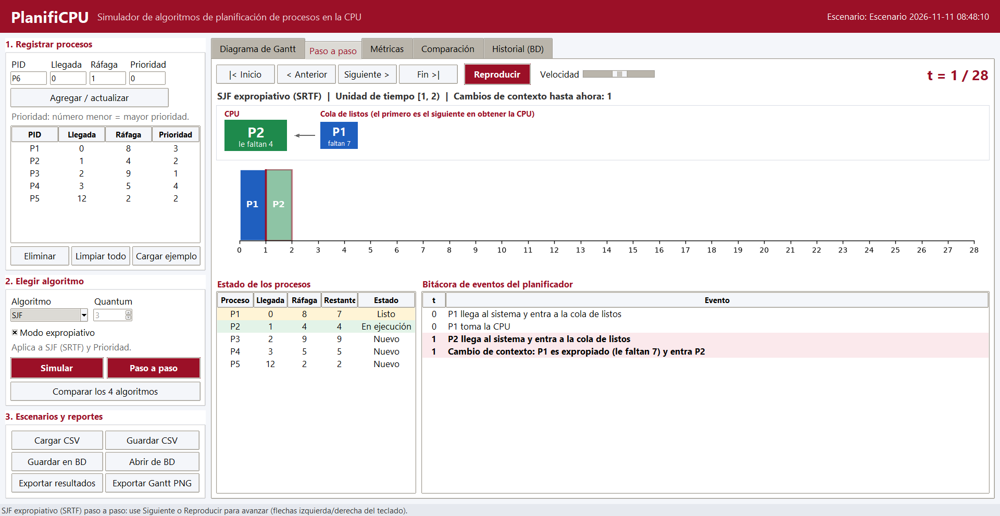

# PlanifiCPU

**Simulador de algoritmos de planificación de procesos en la CPU**

Universidad Manuela Beltrán · Sistemas Operativos · Grupo G11 · 2026<br>
Fase II: avance funcional, pruebas y evidencias (ABP) · versión 1.1



## Contenido

1. [Nombre del proyecto](#1-nombre-del-proyecto)
2. [Descripción general](#2-descripción-general)
3. [Levantamiento de información](#3-levantamiento-de-información)
4. [Problemática que aborda](#4-problemática-que-aborda)
5. [Objetivos](#5-objetivos)
6. [Alcance](#6-alcance)
7. [Funcionalidades principales](#7-funcionalidades-principales)
8. [Arquitectura y estructura general](#8-arquitectura-y-estructura-general)
   1. [Componentes y módulos](#81-componentes-y-módulos)
   2. [Arquitectura inicial](#82-arquitectura-inicial)
   3. [Organización de archivos y directorios](#83-organización-de-archivos-y-directorios)
   4. [Frontend](#84-frontend)
   5. [Commits](#85-commits)
   6. [Base de datos](#86-base-de-datos)
   7. [Modelo relacional](#87-modelo-relacional)
9. [Tecnologías utilizadas](#9-tecnologías-utilizadas)
10. [Requisitos iniciales de ejecución](#10-requisitos-iniciales-de-ejecución)
11. [Integrantes del equipo](#11-integrantes-del-equipo)
12. [Estado actual y próximos avances](#12-estado-actual-y-próximos-avances)
13. [Fase II: avance realizado](#13-fase-ii-avance-realizado)
14. [Documentación técnica y referencias](#14-documentación-técnica-y-referencias)

---

## 1. Nombre del proyecto

**PlanifiCPU**: simulador de algoritmos de planificación de procesos en la CPU.

## 2. Descripción general

PlanifiCPU es una aplicación de escritorio desarrollada en Python que simula los algoritmos de planificación de CPU **FCFS, SJF (con y sin expropiación), Round Robin y por Prioridad (con y sin expropiación)**. A partir de una lista de procesos con su tiempo de llegada, ráfaga de CPU y prioridad, genera el **diagrama de Gantt** de la ejecución, permite recorrerla **paso a paso** viendo la CPU y la cola de listos en cada instante, registra cada **cambio de contexto**, calcula los tiempos de **espera, retorno y respuesta**, y **compara** el desempeño de los cuatro algoritmos con el mismo conjunto de procesos. Los escenarios y el historial de simulaciones se guardan en una base de datos SQLite local.

## 3. Levantamiento de información

**Contexto.** En la asignatura de Sistemas Operativos, la planificación de CPU se estudia resolviendo ejercicios en papel: se entrega una tabla de procesos con su tiempo de llegada, ráfaga de CPU y prioridad, y el estudiante debe dibujar el diagrama de Gantt y calcular los tiempos de espera, retorno y respuesta para cada algoritmo.

| Técnica | Qué se hizo | Qué se obtuvo |
|---|---|---|
| Revisión documental | Lectura de la bibliografía del curso sobre planificación de CPU. | Definición de los algoritmos, fórmulas de las métricas y convenciones de desempate. |
| Análisis de ejercicios del curso | Revisión del formato de los ejercicios que se resuelven a mano (PID, llegada, ráfaga, prioridad). | Formato de entrada del simulador y del archivo CSV. |
| Identificación de usuarios | Se identificó quién usa la herramienta y para qué. | Dos actores: estudiante y docente. |
| Ficha técnica del proyecto | Definición de objetivo, funcionalidad, entradas, procesamiento, salidas y alcance. | Requerimientos funcionales y no funcionales ([requerimientos.pdf](documentacion/requerimientos.pdf)). |

**Usuarios o beneficiarios**

| Usuario | Tipo | Necesidad que atiende |
|---|---|---|
| Estudiante de Sistemas Operativos | Beneficiario principal | Comprobar sus ejercicios resueltos a mano y entender por qué un algoritmo da mejores tiempos que otro. |
| Docente de Sistemas Operativos | Usuario | Mostrar en clase la ejecución paso a paso y preparar ejemplos con resultado verificable. |
| Equipo de desarrollo (G11) | Beneficiario indirecto | Aplicar en un producto real los conceptos de planificación vistos en el curso. |

**Requerimientos funcionales**

| ID | Requerimiento | Prioridad |
|---|---|---|
| RF01 | Registrar, editar y eliminar procesos con PID, tiempo de llegada, ráfaga de CPU y prioridad. | Alta |
| RF02 | Validar los datos: PID único y obligatorio, llegada ≥ 0, ráfaga ≥ 1, prioridad ≥ 0, valores enteros. | Alta |
| RF03 | Elegir el algoritmo: FCFS, SJF, Round Robin (con quantum) o Prioridad. | Alta |
| RF04 | Permitir el modo expropiativo en SJF (SRTF) y en Prioridad. | Media |
| RF05 | Generar el diagrama de Gantt y el registro de cada tramo y cambio de contexto. | Alta |
| RF06 | Calcular por proceso el tiempo de espera, retorno y respuesta, y sus promedios. | Alta |
| RF07 | Comparar los cuatro algoritmos con el mismo conjunto de procesos (tabla y gráfica). | Media |
| RF08 | Cargar escenarios desde CSV y exportar escenarios, resultados (CSV) y el Gantt (PNG). | Media |
| RF09 | Guardar escenarios en una base de datos local y consultar el historial de simulaciones. | Baja |

**Requerimientos no funcionales**

| ID | Atributo | Requerimiento |
|---|---|---|
| RNF01 | Portabilidad | Aplicación de escritorio para Windows 10/11, sin conexión a internet ni servidor. |
| RNF02 | Usabilidad | Interfaz en español organizada en pasos; decimales con coma (3,33). |
| RNF03 | Exactitud | Los cálculos deben coincidir con los ejercicios resueltos a mano; se verifican con pruebas automáticas. |
| RNF04 | Mantenibilidad | Código separado por capas: interfaz, motor, métricas, archivos y base de datos. |
| RNF05 | Rendimiento | Una simulación de hasta 50 procesos se muestra en menos de 1 segundo. |
| RNF06 | Integridad de datos | Llaves foráneas, restricciones CHECK y borrado en cascada en la base de datos. |
| RNF07 | Control de versiones | Código versionado en GitHub con commits descriptivos de cada avance. |

**Reglas de cálculo** (las mismas de los ejercicios del curso)

- El reloj avanza en unidades enteras de tiempo.
- **Retorno** = fin − llegada · **Espera** = retorno − ráfaga · **Respuesta** = primer uso de CPU − llegada.
- **Prioridad**: número menor = prioridad mayor.
- **Empates**: gana el proceso que llegó primero; si llegaron al mismo tiempo, el que se registró primero.
- **Modo expropiativo**: ante un empate se mantiene el proceso que ya está en la CPU.
- **Round Robin**: los procesos que llegan durante un quantum entran a la cola antes que el proceso expropiado.
- **Cambio de contexto**: cada vez que la CPU pasa a ejecutar un proceso distinto del anterior. Sin procesos listos, la CPU queda **ociosa**.

## 4. Problemática que aborda

**Problemática.** La planificación de CPU es un tema **abstracto** y en el curso se resuelve **a mano en papel**. Esto genera tres dificultades:

1. **No hay forma rápida de verificar** si el Gantt y los tiempos calculados son correctos; un error en un tramo se arrastra a todas las métricas.
2. **Comparar algoritmos es lento**: hay que repetir el ejercicio completo cuatro veces con los mismos datos.
3. **No se ve la ejecución en el tiempo**: en papel no es evidente cuándo ocurre una expropiación o un cambio de contexto, que es lo que diferencia a los algoritmos.

**Necesidad.** Una herramienta que permita **ver y comparar de forma visual** la planificación de CPU: ingresar los procesos una sola vez, obtener el Gantt con sus métricas, comparar los cuatro algoritmos y guardar los escenarios.

**Justificación de la solución.**

- Convierte un tema abstracto en algo visible: el Gantt y el registro de ejecución muestran cada despacho, expropiación y cambio de contexto.
- Permite verificar los ejercicios hechos a mano: el motor sigue las convenciones del curso y se valida con pruebas sobre ejercicios de resultado conocido.
- Ahorra tiempo al comparar: con un clic se ejecutan los cuatro algoritmos sobre los mismos procesos.
- Es viable para el equipo: Python y herramientas incluidas en él (Tkinter, SQLite), sin servidor ni internet, en los equipos con Windows de estudiantes y docente.

## 5. Objetivos

**General.** Desarrollar una aplicación de escritorio en Python que simule los algoritmos de planificación de CPU FCFS, SJF, Round Robin y por Prioridad, para visualizar mediante diagramas de Gantt cómo el sistema operativo asigna el procesador a los procesos y comparar su desempeño con métricas de tiempo.

**Específicos.**

1. Implementar los algoritmos FCFS, SJF (con y sin expropiación), Round Robin y Prioridad (con y sin expropiación).
2. Generar el diagrama de Gantt y el registro de cambios de contexto de cada simulación.
3. Calcular los tiempos de espera, retorno y respuesta por proceso y en promedio.
4. Comparar los cuatro algoritmos con el mismo conjunto de procesos mediante una tabla y una gráfica.
5. Guardar escenarios y resultados en archivos CSV y en una base de datos SQLite local.

## 6. Alcance

| Incluye | No incluye |
|---|---|
| 4 algoritmos: FCFS, SJF, Round Robin y Prioridad (SJF y Prioridad con y sin expropiación) | Planificar procesos reales del sistema operativo |
| Diagrama de Gantt, registro de ejecución y métricas por proceso | Sistemas multiprocesador o multinúcleo |
| Comparación de los 4 algoritmos | Operaciones de E/S ni gestión de memoria |
| Carga y exportación en CSV; Gantt en PNG | Versión web o móvil |
| Base de datos SQLite local para escenarios e historial | Usuarios, login o servidor de base de datos |
| Código en GitHub, pruebas automáticas y manual de uso (este README) | |

## 7. Funcionalidades principales

| # | Funcionalidad | Descripción |
|---|---|---|
| 1 | Registrar procesos | PID, tiempo de llegada, ráfaga de CPU y prioridad; editar y eliminar. |
| 2 | Elegir algoritmo | FCFS, SJF, Round Robin (con quantum) o Prioridad; modo expropiativo en SJF y Prioridad. |
| 3 | Generar el diagrama de Gantt | Tramos de ejecución, CPU ociosa y registro de cada cambio de contexto. |
| 4 | Calcular métricas | Tiempo de espera, de retorno y de respuesta por proceso y promedios. |
| 5 | Comparar algoritmos | Los 4 algoritmos con el mismo conjunto de procesos, en tabla y gráfica. |
| 6 | Cargar y exportar | Escenarios en CSV, resultados en CSV y el Gantt en PNG. |
| 7 | Historial | Escenarios y simulaciones guardados en SQLite, con opción de reabrirlos. |
| 8 | Paso a paso (Fase II) | Recorre la simulación unidad por unidad: proceso en CPU, cola de listos, estados, ráfaga restante y bitácora de eventos. |

### Relación con los conceptos de Sistemas Operativos

| Concepto | Cómo se aplica en PlanifiCPU |
|---|---|
| Planificador de corto plazo (despachador) | El motor decide en cada instante qué proceso de la cola de listos pasa a ejecución. |
| Estados de un proceso | Nuevo (registro), listo (cola de listos), ejecución (tramo del Gantt) y terminado. |
| Algoritmos de planificación | FCFS, SJF/SRTF, Round Robin y Prioridad, con sus reglas de selección. |
| Expropiación | Modo no expropiativo vs. expropiativo; quantum en Round Robin. |
| Cambio de contexto | Se cuenta y se registra cada vez que la CPU pasa a otro proceso. |
| Métricas de planificación | Tiempo de espera, retorno y respuesta; tiempos de CPU ociosa. |
| Inanición | Se puede observar en Prioridad y SJF cuando llegan de forma continua procesos más prioritarios o más cortos. |



## 8. Arquitectura y estructura general

### 8.1 Componentes y módulos

| Módulo | Archivo(s) | Responsabilidad |
|---|---|---|
| Interfaz gráfica | `gui.py` | Formularios, tablas, pestañas de resultados y diálogos de archivo (Tkinter + Matplotlib). |
| Gestor de procesos | `modelos.py`, `csv_io.py` | Crea y valida los procesos; carga escenarios desde CSV. |
| Motor de planificación | `algoritmos.py` | Un algoritmo por función con una interfaz común: `simular(procesos, algoritmo, quantum, expropiativo)`. |
| Traza paso a paso (Fase II) | `paso_a_paso.py` | Expande el Gantt en instantes con CPU, cola de listos, estados y eventos: `trazar(procesos, resultado)`. |
| Métricas y reportes | `metricas.py`, `csv_io.py` | Cálculo de tiempos, comparación y exportación a CSV/PNG. |
| Persistencia | `bd.py`, `bd/schema.sql` | Guarda escenarios, simulaciones, resultados y tramos del Gantt en SQLite. |



### 8.2 Arquitectura inicial

Arquitectura en **tres capas** dentro de una aplicación de escritorio. La capa de presentación (Tkinter y Matplotlib) recoge datos y muestra resultados, pero no calcula; delega en la capa de lógica, que valida los procesos, ejecuta el algoritmo y calcula las métricas. Solo la capa de datos lee y escribe archivos CSV/PNG y la base de datos SQLite. Así el motor se prueba sin la interfaz.





### 8.3 Organización de archivos y directorios

```text
PlanifiCPU_SistemasOperativos_G11/
├── README.md                       # presentación del proyecto (este archivo)
├── LICENSE                         # licencia MIT
├── requirements.txt                # dependencias (matplotlib)
├── documentacion/
│   ├── descripcion_proyecto.pdf    # descripción y formulación del proyecto
│   ├── requerimientos.pdf          # requerimientos funcionales y no funcionales
│   ├── arquitectura_inicial.pdf    # componentes, arquitectura, archivos y BD
│   ├── tecnologias_y_referencias.pdf
│   ├── diagramas/                  # diagramas en PNG y su fuente HTML
│   └── fase2/                      # componente paso a paso, pruebas y su salida
├── src/
│   └── codigo_fuente/
│       ├── main.py                 # punto de entrada
│       ├── planificpu/             # gui, algoritmos, paso_a_paso, metricas, modelos, csv_io, bd
│       └── bd/schema.sql           # esquema de la base de datos
├── recursos/
│   ├── imagenes/                   # capturas de la interfaz
│   └── datos_ejemplo/              # escenarios CSV de ejemplo
└── pruebas/
    ├── test_algoritmos.py          # pruebas automáticas del motor (Fase I)
    └── test_paso_a_paso.py         # pruebas del modo paso a paso (Fase II)
```

### 8.4 Frontend

Interfaz de escritorio con **Tkinter** (widgets `ttk`) y gráficas de **Matplotlib** incrustadas, con los colores institucionales. Se abre maximizada y tiene un panel izquierdo de trabajo y un panel derecho de resultados con cinco pestañas.

| Sección | Controles |
|---|---|
| 1. Registrar procesos | Campos PID, Llegada, Ráfaga y Prioridad; *Agregar / actualizar*; tabla de procesos (al seleccionar una fila se carga para editarla); *Eliminar*, *Limpiar todo*, *Cargar ejemplo*. |
| 2. Elegir algoritmo | Lista con los 4 algoritmos, quantum (solo Round Robin), *Modo expropiativo* (solo SJF y Prioridad), *Simular*, *Paso a paso* y *Comparar los 4 algoritmos*. |
| 3. Escenarios y reportes | *Cargar CSV*, *Guardar CSV*, *Guardar en BD*, *Abrir de BD*, *Exportar resultados* y *Exportar Gantt PNG*. |

**Diagrama de Gantt** con el registro de ejecución (quién toma la CPU, cambios de contexto, expropiaciones y fin de cada proceso). Ejemplo de la ficha técnica con FCFS:


**Paso a paso** (Fase II): controles para avanzar, retroceder o reproducir; proceso en CPU y cola de listos; Gantt que se construye unidad por unidad; estado de cada proceso y bitácora de eventos. Round Robin q=3 en t=7:


**Métricas** por proceso con la fila de promedios (FCFS: espera promedio 3,33 y retorno promedio 7,33):



**Comparación** de los cuatro algoritmos con el mismo conjunto de procesos:



**Historial (BD)** de simulaciones guardadas:


> Las capturas son de la aplicación real, con los escenarios de `recursos/datos_ejemplo/`.

### 8.5 Commits

El historial sigue **Conventional Commits** (`tipo(ámbito): descripción`) y registra la creación y cada avance del proyecto:

| # | Commit | Tipo | Qué agrega |
|---|---|---|---|
| 1 | [`96616e3`](https://github.com/daviid0611/PlanifiCPU_SistemasOperativos_G11/commit/96616e3) | chore | Estructura inicial: paquete `planificpu`, `.gitignore` y `requirements.txt`. |
| 2 | [`435a2b2`](https://github.com/daviid0611/PlanifiCPU_SistemasOperativos_G11/commit/435a2b2) | feat(motor) | Modelos `Proceso`, `Segmento`, `Resultado` y validación de datos. |
| 3 | [`3b0e152`](https://github.com/daviid0611/PlanifiCPU_SistemasOperativos_G11/commit/3b0e152) | feat(motor) | Algoritmos FCFS, SJF, Round Robin y Prioridad, y cálculo de métricas. |
| 4 | [`ede08a4`](https://github.com/daviid0611/PlanifiCPU_SistemasOperativos_G11/commit/ede08a4) | feat(csv) | Carga de escenarios y exportación de resultados en CSV. |
| 5 | [`f6231b3`](https://github.com/daviid0611/PlanifiCPU_SistemasOperativos_G11/commit/f6231b3) | feat(bd) | Esquema SQLite y persistencia de escenarios y simulaciones. |
| 6 | [`3122de2`](https://github.com/daviid0611/PlanifiCPU_SistemasOperativos_G11/commit/3122de2) | feat(gui) | Interfaz Tkinter con Gantt, métricas, comparación e historial. |
| 7 | [`0c245e2`](https://github.com/daviid0611/PlanifiCPU_SistemasOperativos_G11/commit/0c245e2) | test | 13 pruebas automáticas del motor. |
| 8 | [`bd8ddd9`](https://github.com/daviid0611/PlanifiCPU_SistemasOperativos_G11/commit/bd8ddd9) | docs | Capturas reales de la interfaz. |
| 9 | [`a65d8de`](https://github.com/daviid0611/PlanifiCPU_SistemasOperativos_G11/commit/a65d8de) | docs | Primera versión del README. |
| 10 | [`53d48d6`](https://github.com/daviid0611/PlanifiCPU_SistemasOperativos_G11/commit/53d48d6) | refactor | Estructura de carpetas de la guía (`src/`, `pruebas/`, `recursos/`, `documentacion/`) y licencia MIT. |
| 11 | [`6769e16`](https://github.com/daviid0611/PlanifiCPU_SistemasOperativos_G11/commit/6769e16) | docs | Diagramas de estructura, arquitectura, archivos, modelo relacional y conceptos de S.O. |
| 12 | [`286ce53`](https://github.com/daviid0611/PlanifiCPU_SistemasOperativos_G11/commit/286ce53) | docs | Documentos PDF de la carpeta `documentacion/`. |
| 13 | [`76865e6`](https://github.com/daviid0611/PlanifiCPU_SistemasOperativos_G11/commit/76865e6) | docs | README completo según la guía. |
| 14 | [`09f7f5e`](https://github.com/daviid0611/PlanifiCPU_SistemasOperativos_G11/commit/09f7f5e) | chore | `.gitattributes` para que GitHub no cuente los HTML de diagramas como código; ajuste del encabezado del README. |
| 15 | [`491e0f4`](https://github.com/daviid0611/PlanifiCPU_SistemasOperativos_G11/commit/491e0f4) | feat(paso-a-paso) | **Fase II.** Módulo `paso_a_paso.py`: traza instante por instante con CPU, cola de listos, estados y eventos. |
| 16 | [`2f8faf3`](https://github.com/daviid0611/PlanifiCPU_SistemasOperativos_G11/commit/2f8faf3) | test(paso-a-paso) | **Fase II.** 14 pruebas: casos límite y 420 simulaciones aleatorias contra el motor. |
| 17 | [`6f3bd28`](https://github.com/daviid0611/PlanifiCPU_SistemasOperativos_G11/commit/6f3bd28) | feat(gui) | **Fase II.** Pestaña *Paso a paso* con controles, reproducción, Gantt parcial y bitácora. |
| 18 | [`0add69c`](https://github.com/daviid0611/PlanifiCPU_SistemasOperativos_G11/commit/0add69c) | docs | **Fase II.** Capturas y animación del modo paso a paso. |
| 19 | [`a8a8221`](https://github.com/daviid0611/PlanifiCPU_SistemasOperativos_G11/commit/a8a8221) | docs(fase2) | **Fase II.** Documentación del componente y reporte de pruebas. |
| 20 | último commit | docs | **Fase II.** README actualizado con el avance, el entorno, las pruebas y las evidencias. |

Historial completo: [commits/main](https://github.com/daviid0611/PlanifiCPU_SistemasOperativos_G11/commits/main)

### 8.6 Base de datos

| Aspecto | Detalle |
|---|---|
| Motor | **SQLite 3** (módulo `sqlite3` de Python). |
| Archivo | `src/codigo_fuente/bd/planificpu.db`; se crea solo la primera vez que se abre la aplicación. No se sube a GitHub. |
| Esquema | [`src/codigo_fuente/bd/schema.sql`](src/codigo_fuente/bd/schema.sql), con `CREATE TABLE IF NOT EXISTS`. |
| Integridad | `PRAGMA foreign_keys = ON`, restricciones `CHECK` (ráfaga ≥ 1, llegada ≥ 0, quantum ≥ 1) y `UNIQUE (id_escenario, pid)`. |
| Borrado | `ON DELETE CASCADE`: al eliminar un escenario se borran sus procesos, simulaciones, resultados y tramos. |
| Guardado | Cada *Simular* o *Comparar* guarda la simulación; si el escenario no tiene nombre, se crea uno con la fecha y hora. |

| Tabla | Qué guarda |
|---|---|
| `algoritmo` | Catálogo de los 4 algoritmos y si permiten expropiación o usan quantum. |
| `escenario` | Conjunto de procesos con nombre y fecha de creación. |
| `proceso` | Procesos de cada escenario (PID, llegada, ráfaga, prioridad y orden de registro). |
| `simulacion` | Cada ejecución de un algoritmo sobre un escenario, con quantum, modo y promedios. |
| `resultado_proceso` | Métricas de cada proceso en una simulación. |
| `segmento_gantt` | Tramos del Gantt en orden; `id_proceso` nulo = CPU ociosa. |

### 8.7 Modelo relacional



| Relación | Cardinalidad | Explicación |
|---|---|---|
| ESCENARIO – PROCESO | 1 : N | Un escenario tiene varios procesos; cada proceso pertenece a uno solo. |
| ESCENARIO – SIMULACION | 1 : N | El mismo escenario se puede simular muchas veces. |
| ALGORITMO – SIMULACION | 1 : N | Cada simulación usa un algoritmo del catálogo. |
| SIMULACION – PROCESO | N : M | Se resuelve con RESULTADO_PROCESO, que guarda las métricas de cada proceso en cada simulación. |
| SIMULACION – SEGMENTO_GANTT | 1 : N | Una simulación tiene varios tramos ordenados. |
| PROCESO – SEGMENTO_GANTT | 0..1 : N | Un tramo pertenece a un proceso o a ninguno (CPU ociosa). |

**Normalización.** Tercera forma normal (3FN): cada atributo depende solo de la llave de su tabla y los datos del proceso no se repiten en los resultados. Los promedios de `simulacion` son datos derivados que se guardan a propósito para consultar el historial sin recalcular.

## 9. Tecnologías utilizadas

| Tecnología / herramienta | Versión | Uso en el proyecto | Por qué se eligió |
|---|---|---|---|
| **Python** | 3.12+ (probado en 3.14.6) | Lenguaje de toda la aplicación. | Visto en la carrera, sintaxis clara para los algoritmos, librería estándar amplia. |
| **Tkinter / ttk** | Tk 8.6 (incluido) | Interfaz gráfica de escritorio. | Viene con Python y funciona en Windows 10/11 sin instalar nada más. |
| **Matplotlib** | 3.8+ (probado en 3.11.2) | Diagrama de Gantt y gráfica comparativa. | Librería estándar de gráficas; exporta el Gantt a PNG. |
| **SQLite** | 3 (probado en 3.50.4) | Base de datos local de escenarios e historial. | Un solo archivo, sin servidor ni usuarios. |
| **csv y unittest** | Librería estándar | Archivos CSV y pruebas automáticas. | Sin dependencias externas. |
| **Git y GitHub** | Git 2.54 | Control de versiones y repositorio público. | Centraliza el desarrollo y evidencia los avances. |
| **Visual Studio Code** | Actual | Editor de código. | Ligero, con soporte para Python y Git. |
| **HTML/CSS + Chrome** | Actual | Diagramas y documentos PDF. | Diagramas versionables como texto y exportables a PNG/PDF. |
| **Microsoft Word** | Microsoft 365 | Documento técnico en formato APA 7. | Plantilla institucional de la universidad. |
| **Windows 10/11** | 64 bits | Sistema operativo de desarrollo y ejecución. | Sistema de los equipos de estudiantes y docente. |

## 10. Requisitos iniciales de ejecución

| Hardware | Mínimo recomendado |
|---|---|
| Procesador | Doble núcleo de 1,6 GHz o superior |
| Memoria RAM | 4 GB (recomendado 8 GB) |
| Almacenamiento | 500 MB libres |
| Pantalla | 1366 × 768 o superior |

| Software | Requisito |
|---|---|
| Sistema operativo | Windows 10 u 11 de 64 bits (entorno previsto) |
| Intérprete | Python 3.12 o superior, con Tkinter y sqlite3 (incluidos en el instalador oficial) |
| Librerías | Matplotlib 3.8 o superior |

No requiere virtualización, servidor ni conexión a internet.

**Instalación y ejecución**

```bash
git clone https://github.com/daviid0611/PlanifiCPU_SistemasOperativos_G11.git
cd PlanifiCPU_SistemasOperativos_G11
python -m pip install -r requirements.txt
python src/codigo_fuente/main.py
```

**Uso básico**

1. Pulse **Cargar ejemplo** o **Cargar CSV** (archivos en `recursos/datos_ejemplo/`), o registre los procesos uno a uno.
2. Elija el algoritmo; para Round Robin indique el quantum.
3. Pulse **Simular** para ver el Gantt y las métricas, **Paso a paso** para recorrer la ejecución instante por instante (botones o flechas del teclado), o **Comparar los 4 algoritmos**.
4. Exporte los resultados (CSV) o el Gantt (PNG). Cada simulación queda en el **Historial (BD)**.

Formato del CSV (coma o punto y coma; `prioridad` es opcional):

```csv
pid;llegada;rafaga;prioridad
P1;0;5;2
P2;1;3;1
P3;2;4;3
```

**Pruebas automáticas** (27 pruebas: 13 del motor con el ejemplo de la ficha técnica y ejercicios clásicos de Silberschatz, y 14 del modo paso a paso):

```bash
python -m unittest discover -s pruebas -v
```

## 11. Integrantes del equipo

| Integrante | Usuario de GitHub | Rol en el proyecto |
|---|---|---|
| David Zambrano | [@daviid0611](https://github.com/daviid0611) | Integrante |
| Daniel Pérez | [@monarca1290](https://github.com/monarca1290) | Integrante |
| Axel Salgado | [@AxelN28](https://github.com/AxelN28) | Integrante |

Grupo G11 · Sistemas Operativos · Facultad de Ingeniería · Universidad Manuela Beltrán.

## 12. Estado actual y próximos avances

**Estado actual: versión 1.1 (Fase II).** Están implementados los cuatro algoritmos (con y sin expropiación), el diagrama de Gantt con registro de ejecución, el **modo paso a paso**, las métricas, la comparación de algoritmos, la carga y exportación en CSV/PNG y la base de datos SQLite con historial. Pasan 27 pruebas automáticas.

**Próximos avances**

- [x] Modo paso a paso: avanzar la simulación unidad por unidad mostrando la cola de listos en cada instante (Fase II).
- [x] Pruebas con casos límite del modo paso a paso: misma llegada, CPU ociosa, quantum grande y 420 simulaciones aleatorias (Fase II).
- [ ] Validar el simulador con los ejercicios propuestos por el docente en clase.
- [ ] Manual de usuario con capturas en `documentacion/`.
- [ ] Empaquetar la aplicación como ejecutable `.exe` para Windows (PyInstaller).

## 13. Fase II: avance realizado

**Objetivo de la fase.** Pasar de mostrar solo el resultado final a mostrar **cómo decide el planificador de corto plazo** en cada instante, que es lo que en papel no se ve (problemática 3 de la sección 4).

| Evidencia pedida | Dónde está |
|---|---|
| Avance funcional | Modo **paso a paso** en la interfaz: botón *Paso a paso* y pestaña nueva ([animación](recursos/imagenes/08_paso_a_paso.gif)). |
| Configuración del entorno | Tabla siguiente y [sección 10](#10-requisitos-iniciales-de-ejecución). |
| Componentes principales | [`paso_a_paso.py`](src/codigo_fuente/planificpu/paso_a_paso.py) (lógica) y la pestaña en [`gui.py`](src/codigo_fuente/planificpu/gui.py), documentados en [componente_paso_a_paso.md](documentacion/fase2/componente_paso_a_paso.md). |
| Pruebas de funcionamiento | [`test_paso_a_paso.py`](pruebas/test_paso_a_paso.py) y el reporte [pruebas_fase2.md](documentacion/fase2/pruebas_fase2.md): 27 de 27 correctas ([salida](documentacion/fase2/salida_pruebas.txt)). |
| Evidencias del desarrollo | Capturas [06](recursos/imagenes/06_paso_a_paso_round_robin.png) y [07](recursos/imagenes/07_paso_a_paso_srtf_expropiacion.png), animación [08](recursos/imagenes/08_paso_a_paso.gif) y commits de la fase. |

**Configuración del entorno de trabajo**

| Elemento | Configuración usada |
|---|---|
| Sistema operativo | Windows 11 de 64 bits con escalado de pantalla; `main.py` activa `SetProcessDpiAwareness(1)` para que la interfaz se vea nítida. |
| Intérprete | Python 3.14.6 (instalador oficial, con Tkinter 8.6 y sqlite3). |
| Dependencias | `python -m pip install -r requirements.txt` (Matplotlib 3.11.2). Opcional: entorno virtual con `python -m venv .venv` y `.venv\Scripts\activate`; la carpeta `.venv/` está en `.gitignore`. |
| Base de datos | SQLite 3.50.4; `src/codigo_fuente/bd/planificpu.db` se crea sola desde `schema.sql` en la primera ejecución. |
| Control de versiones | Git 2.54 y GitHub, rama `main`, mensajes con Conventional Commits. |

**Qué muestra el modo paso a paso en cada instante `t`**

- Proceso en la **CPU** (o CPU ociosa) y cuánto le falta.
- **Cola de listos** en el orden en que el planificador los atenderá; en Round Robin, el orden real de la cola FIFO.
- **Estado** de cada proceso (Nuevo, Listo, En ejecución, Terminado) y su ráfaga restante.
- **Bitácora**: llegadas, despachos, expropiaciones, fin de quantum, cambios de contexto y terminaciones.
- **Gantt parcial** que se construye unidad por unidad, con la unidad actual resaltada.



**Resultados obtenidos**

- El paso a paso se calcula a partir del Gantt del motor, así que **siempre coincide** con el Gantt y las métricas de la Fase I; la prueba con 420 simulaciones aleatorias lo comprueba instante por instante.
- El ejercicio de cinco procesos con Round Robin (q=3) se verificó a mano en t=7: CPU P3, cola P4, P1, P2 ([verificación](documentacion/fase2/pruebas_fase2.md)).
- Las funciones de la Fase I (Simular, Comparar, CSV, BD) siguen funcionando: sus 13 pruebas pasan sin cambios.

**Commits de la Fase II**: filas 15 a 20 de la [sección 8.5](#85-commits).

## 14. Documentación técnica y referencias

| Documento | Contenido |
|---|---|
| [descripcion_proyecto.pdf](documentacion/descripcion_proyecto.pdf) | Descripción y formulación: problemática, justificación, objetivos, alcance, usuarios, funcionalidades y relación con S.O. |
| [requerimientos.pdf](documentacion/requerimientos.pdf) | Requerimientos funcionales y no funcionales, reglas de cálculo, hardware y software. |
| [arquitectura_inicial.pdf](documentacion/arquitectura_inicial.pdf) | Componentes, diagrama de estructura, arquitectura, organización de archivos y modelo relacional. |
| [tecnologias_y_referencias.pdf](documentacion/tecnologias_y_referencias.pdf) | Relación de tecnologías y herramientas, y referencias bibliográficas. |
| [diagramas/](documentacion/diagramas) | Diagramas en PNG con su fuente HTML. |
| [fase2/componente_paso_a_paso.md](documentacion/fase2/componente_paso_a_paso.md) | Fase II: diseño, estructura de datos, eventos y decisiones del modo paso a paso. |
| [fase2/pruebas_fase2.md](documentacion/fase2/pruebas_fase2.md) | Fase II: pruebas automáticas y manuales con sus resultados. |

**Referencias**

- Silberschatz, A., Galvin, P. B. y Gagne, G. (2018). *Operating system concepts* (10.ª ed.). Wiley.
- Tanenbaum, A. S. y Bos, H. (2015). *Modern operating systems* (4.ª ed.). Pearson.
- Stallings, W. (2018). *Operating systems: Internals and design principles* (9.ª ed.). Pearson.
- Python Software Foundation. (2026). *tkinter* y *sqlite3*. https://docs.python.org/3/library/
- Matplotlib Development Team. (2026). *Matplotlib: Visualization with Python*. https://matplotlib.org/
- SQLite Consortium. (2026). *SQLite documentation*. https://www.sqlite.org/docs.html
- Chacon, S. y Straub, B. (2014). *Pro Git* (2.ª ed.). Apress. https://git-scm.com/book/es/v2

---

Licencia [MIT](LICENSE) · Grupo G11 · Sistemas Operativos · Universidad Manuela Beltrán · 2026
