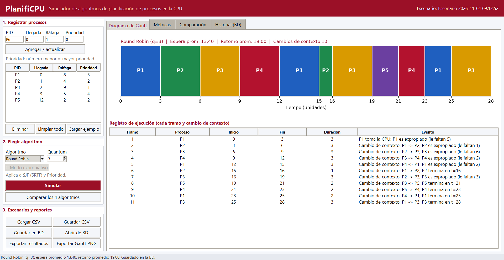
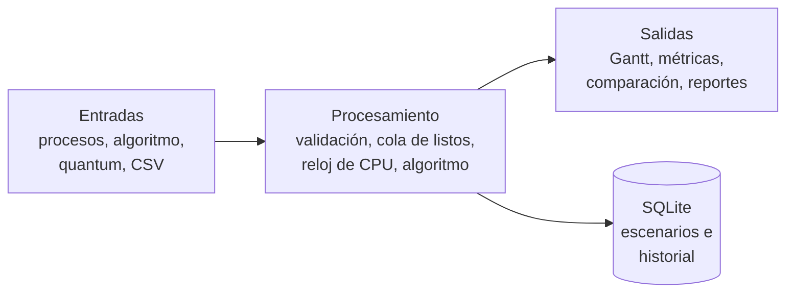
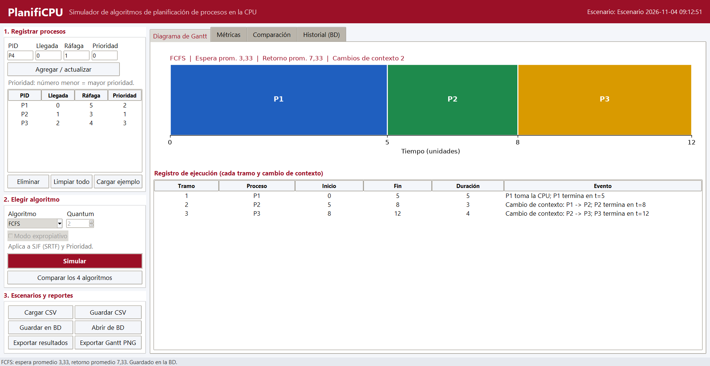
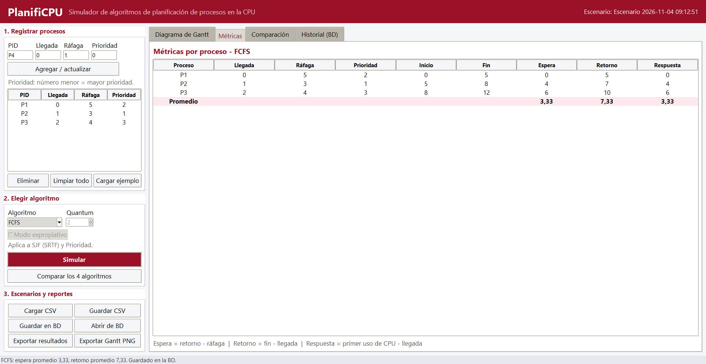
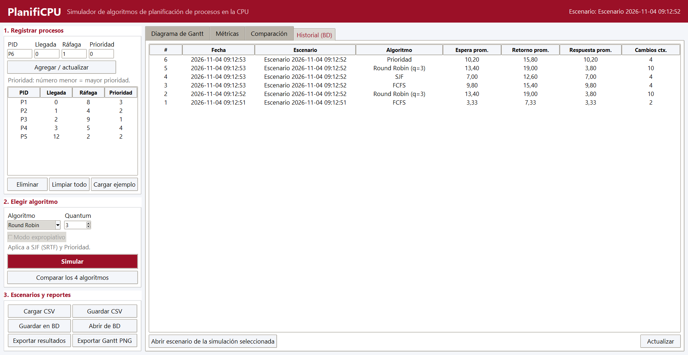
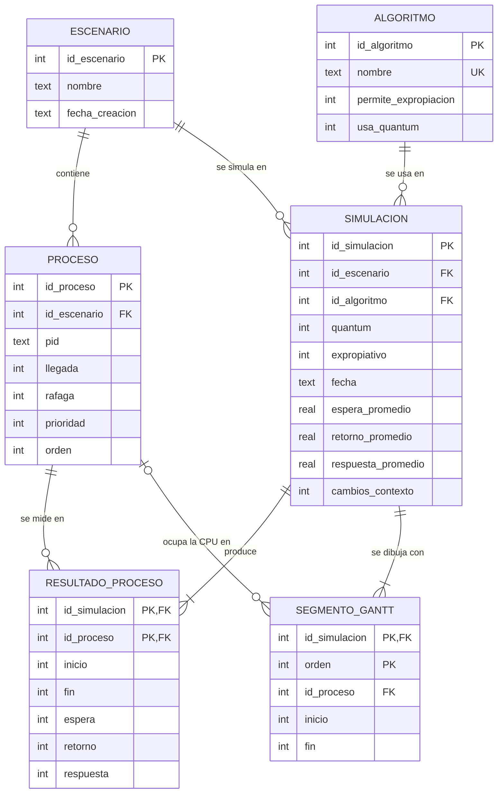

# PlanifiCPU

**Simulador de algoritmos de planificación de procesos en la CPU**

Universidad Manuela Beltrán · Sistemas Operativos · Actividad 1: Punto de partida del proyecto (ABP)
Estudiante: David Zambrano · Ingeniería de Software · 2026



## Contenido

1. [Levantamiento de información](#1-levantamiento-de-información)
2. [Necesidad y problemática](#2-necesidad-y-problemática)
3. [Descripción del proyecto](#3-descripción-del-proyecto)
4. [Estructura del prototipo](#4-estructura-del-prototipo)
   1. [Frontend](#41-frontend)
   2. [Commits](#42-commits)
   3. [Base de datos](#43-base-de-datos)
   4. [Modelo relacional](#44-modelo-relacional)
   5. [Tecnologías](#45-tecnologías)

---

## 1. Levantamiento de información

### 1.1 Contexto

En la asignatura de Sistemas Operativos, la planificación de CPU se estudia resolviendo ejercicios en papel: se da una tabla de procesos con su tiempo de llegada, ráfaga de CPU y prioridad, y el estudiante debe dibujar el diagrama de Gantt y calcular los tiempos de espera, retorno y respuesta para cada algoritmo.

### 1.2 Técnicas utilizadas

| Técnica | Qué se hizo | Qué se obtuvo |
|---|---|---|
| Revisión documental | Lectura de la bibliografía del curso sobre planificación de CPU (ver [referencias](#referencias)). | Definición de los algoritmos, fórmulas de las métricas y convenciones de desempate. |
| Análisis de ejercicios del curso | Revisión del formato de los ejercicios que se resuelven a mano (tabla PID, llegada, ráfaga, prioridad). | Formato de entrada del simulador y del archivo CSV. |
| Identificación de usuarios | Se identificó quién usa la herramienta y para qué. | Dos actores: estudiante y docente. |
| Ficha técnica del proyecto | Definición de objetivo, funcionalidad, entradas, procesamiento, salidas y alcance. | Requisitos funcionales y no funcionales de esta sección. |

### 1.3 Actores

| Actor | Necesidad |
|---|---|
| Estudiante | Comprobar sus ejercicios resueltos a mano y entender por qué un algoritmo da mejores tiempos que otro. |
| Docente | Mostrar en clase la ejecución paso a paso y generar ejemplos con resultado verificable. |

### 1.4 Requisitos funcionales

| ID | Requisito |
|---|---|
| RF01 | Registrar, editar y eliminar procesos con PID, tiempo de llegada, ráfaga de CPU y prioridad. |
| RF02 | Validar los datos: PID único y obligatorio, llegada ≥ 0, ráfaga ≥ 1, prioridad ≥ 0, valores enteros. |
| RF03 | Elegir el algoritmo: FCFS, SJF, Round Robin (con quantum) o Prioridad. |
| RF04 | Permitir el modo expropiativo en SJF (SRTF) y en Prioridad. |
| RF05 | Generar el diagrama de Gantt y el registro de cada tramo y cambio de contexto. |
| RF06 | Calcular por proceso el tiempo de espera, retorno y respuesta, y sus promedios. |
| RF07 | Comparar los cuatro algoritmos con el mismo conjunto de procesos (tabla y gráfica). |
| RF08 | Cargar escenarios desde CSV y exportar escenarios, resultados (CSV) y el Gantt (PNG). |
| RF09 | Guardar escenarios en una base de datos local y consultar el historial de simulaciones. |

### 1.5 Requisitos no funcionales

| ID | Requisito |
|---|---|
| RNF01 | Aplicación de escritorio para Windows 10/11, sin conexión a internet ni servidor. |
| RNF02 | Interfaz en español; decimales con coma (formato colombiano, p. ej. `3,33`). |
| RNF03 | Los cálculos deben coincidir con los ejercicios resueltos a mano (verificado con pruebas automáticas). |
| RNF04 | Código separado por capas: interfaz, motor de planificación, métricas, archivos y base de datos. |
| RNF05 | Código fuente versionado en GitHub con commits descriptivos. |

### 1.6 Reglas de cálculo

Son las convenciones que usa el motor; deben coincidir con las del curso.

- El reloj avanza en unidades enteras de tiempo.
- **Retorno** = fin − llegada · **Espera** = retorno − ráfaga · **Respuesta** = primer uso de CPU − llegada.
- **Prioridad**: número menor = prioridad mayor.
- **Empates**: gana el proceso que llegó primero; si llegaron al mismo tiempo, el que se registró primero.
- **Modo expropiativo**: ante un empate se mantiene el proceso que ya está en la CPU.
- **Round Robin**: los procesos que llegan durante un quantum entran a la cola antes que el proceso expropiado al final de ese quantum.
- **Cambio de contexto**: cada vez que la CPU pasa a ejecutar un proceso distinto del anterior.
- Si no hay procesos listos, la CPU queda **ociosa** y se muestra así en el Gantt.

---

## 2. Necesidad y problemática

### Problemática

La planificación de CPU es un tema **abstracto** y en el curso se resuelve **a mano en papel**. Esto genera tres dificultades:

1. **No hay forma rápida de verificar** si el Gantt y los tiempos calculados son correctos; un error en un tramo se arrastra a todas las métricas.
2. **Comparar algoritmos es lento**: para ver qué algoritmo conviene hay que repetir el ejercicio completo cuatro veces con los mismos datos.
3. **No se ve la ejecución en el tiempo**: en papel no es evidente cuándo ocurre una expropiación o un cambio de contexto, que es justamente lo que diferencia a los algoritmos.

### Necesidad

Contar con una herramienta que permita **ver y comparar de forma visual** la planificación de CPU: ingresar los procesos una sola vez, obtener el diagrama de Gantt con sus métricas, comparar los cuatro algoritmos y guardar los escenarios para volver a ellos.

---

## 3. Descripción del proyecto

**PlanifiCPU** es una aplicación de escritorio en Python que simula los algoritmos de planificación de CPU **FCFS, SJF, Round Robin y por Prioridad**, para visualizar mediante **diagramas de Gantt** cómo el sistema operativo asigna el procesador a los procesos y **comparar su desempeño** con métricas de tiempo.

### 3.1 Objetivos

**General.** Desarrollar una aplicación de escritorio en Python que simule los algoritmos de planificación de CPU y permita visualizar y comparar su desempeño.

**Específicos.**
- Implementar los algoritmos FCFS, SJF (con y sin expropiación), Round Robin y Prioridad (con y sin expropiación).
- Generar el diagrama de Gantt y el registro de cambios de contexto de cada simulación.
- Calcular los tiempos de espera, retorno y respuesta por proceso y en promedio.
- Comparar los algoritmos con el mismo conjunto de procesos.
- Guardar escenarios y resultados en CSV y en una base de datos local.

### 3.2 Funcionamiento



| Entradas | Procesamiento | Salidas |
|---|---|---|
| Lista de procesos (PID, llegada, ráfaga, prioridad) | Validación de datos de entrada | Diagrama de Gantt |
| Algoritmo seleccionado | Cola de listos y simulación del reloj de CPU | Tabla de métricas por proceso y promedios |
| Quantum (solo Round Robin) | Ejecución del algoritmo (con o sin expropiación) | Cuadro comparativo entre algoritmos |
| Archivo CSV opcional | Registro de cada cambio de contexto | Reportes exportables (CSV y PNG) |

### 3.3 Alcance

| Incluye | No incluye |
|---|---|
| 4 algoritmos: FCFS, SJF, Round Robin y Prioridad | Planificar procesos reales del sistema operativo |
| Diagrama de Gantt y métricas por proceso | Sistemas multiprocesador o multinúcleo |
| Comparación de algoritmos | Operaciones de E/S ni gestión de memoria |
| Carga y exportación en CSV | Versión web o móvil |
| Base de datos local (SQLite) para escenarios e historial | Usuarios, login o servidor de base de datos |
| Código en GitHub y manual de uso (este README) | |

> La base de datos es un archivo SQLite local que se crea solo al abrir la aplicación. No requiere instalar un servidor ni maneja usuarios, por lo que se mantiene la restricción de la ficha técnica de no incluir usuarios con login.

### 3.4 Instalación y ejecución

Requisitos: Windows 10/11 con Python 3.12 o superior (Tkinter y SQLite vienen incluidos con Python).

```bash
git clone https://github.com/daviid0611/PlanifiCPU_SistemasOperativos_G11.git
cd PlanifiCPU_SistemasOperativos_G11
python -m pip install -r requirements.txt
python main.py
```

Uso básico:
1. Pulse **Cargar ejemplo** (o **Cargar CSV** con un archivo de `datos/`) o registre los procesos uno a uno.
2. Elija el algoritmo; para Round Robin indique el quantum.
3. Pulse **Simular** para ver el Gantt y las métricas, o **Comparar los 4 algoritmos**.
4. Exporte los resultados (CSV) o el Gantt (PNG). Cada simulación queda en el **Historial (BD)**.

Formato del CSV (separado por coma o por punto y coma; la columna `prioridad` es opcional):

```csv
pid;llegada;rafaga;prioridad
P1;0;5;2
P2;1;3;1
P3;2;4;3
```

Pruebas automáticas del motor (13 pruebas: ejemplo de la ficha técnica y ejercicios clásicos de Silberschatz con resultado conocido):

```bash
python -m unittest discover -s tests -v
```

---

## 4. Estructura del prototipo

```text
PlanifiCPU_SistemasOperativos_G11/
├── main.py                  # punto de entrada
├── planificpu/
│   ├── gui.py               # frontend: interfaz gráfica (Tkinter + Matplotlib)
│   ├── algoritmos.py        # motor de planificación (FCFS, SJF, RR, Prioridad)
│   ├── metricas.py          # cálculo de espera, retorno y respuesta
│   ├── modelos.py           # Proceso, Segmento, Resultado y validación
│   ├── csv_io.py            # carga y exportación CSV
│   └── bd.py                # acceso a la base de datos SQLite
├── bd/
│   └── schema.sql           # esquema de la base de datos
├── datos/                   # escenarios de ejemplo en CSV
├── tests/                   # pruebas automáticas del motor
└── docs/img/                # capturas de la interfaz
```

La aplicación está organizada en cuatro módulos, igual que en la ficha técnica:

| Módulo | Archivo | Responsabilidad |
|---|---|---|
| Interfaz gráfica | `gui.py` | Formularios, tablas y gráficas. |
| Gestor de procesos | `modelos.py`, `csv_io.py` | Crea y valida los procesos; carga y exporta CSV. |
| Motor de planificación | `algoritmos.py` | Un algoritmo por función con una interfaz común: `simular(procesos, algoritmo, quantum, expropiativo)`. |
| Métricas y reportes | `metricas.py`, `csv_io.py`, `bd.py` | Cálculo de tiempos, exportación y persistencia. |

### 4.1 Frontend

Interfaz de escritorio hecha con **Tkinter** (widgets `ttk`) y gráficas de **Matplotlib** incrustadas. Usa los colores institucionales (rojo UMB) y se abre maximizada. Se divide en un panel izquierdo de trabajo y un panel derecho de resultados con cuatro pestañas.

**Panel izquierdo**

| Sección | Controles |
|---|---|
| 1. Registrar procesos | Campos PID, Llegada, Ráfaga y Prioridad; botón *Agregar / actualizar*; tabla de procesos (al seleccionar una fila se carga en el formulario para editarla); *Eliminar*, *Limpiar todo* y *Cargar ejemplo*. |
| 2. Elegir algoritmo | Lista desplegable con los 4 algoritmos, quantum (se activa solo con Round Robin), casilla *Modo expropiativo* (se activa solo con SJF y Prioridad), botones *Simular* y *Comparar los 4 algoritmos*. |
| 3. Escenarios y reportes | *Cargar CSV*, *Guardar CSV*, *Guardar en BD*, *Abrir de BD*, *Exportar resultados* (CSV) y *Exportar Gantt PNG*. |

**Pestañas de resultados**

**Diagrama de Gantt.** Barra de tiempo con un color por proceso, marcas en cada instante de cambio y el resumen de promedios. Debajo, el registro de ejecución explica cada tramo: quién toma la CPU, los cambios de contexto, las expropiaciones (con la ráfaga que falta) y cuándo termina cada proceso.



**Métricas.** Tabla por proceso con inicio, fin, espera, retorno y respuesta, más la fila de promedios. Con el ejemplo de la ficha técnica (FCFS) da espera promedio **3,33** y retorno promedio **7,33**.



**Comparación.** Corre los cuatro algoritmos con el mismo conjunto de procesos; la tabla resalta el de menor espera promedio y la gráfica de barras compara espera, retorno y respuesta.


**Historial (BD).** Lista las simulaciones guardadas en la base de datos; permite reabrir el escenario de cualquier simulación.



> Las capturas son de la aplicación real, generadas con los archivos de `datos/`.

### 4.2 Commits

El historial sigue la convención **Conventional Commits** (`tipo(ámbito): descripción`) y se construyó por etapas, de modo que cada commit agrega una capa funcional del prototipo:

| # | Commit | Tipo | Qué agrega |
|---|---|---|---|
| 1 | [`96616e3`](https://github.com/daviid0611/PlanifiCPU_SistemasOperativos_G11/commit/96616e3) | chore | Estructura inicial: paquete `planificpu`, `.gitignore` y `requirements.txt`. |
| 2 | [`435a2b2`](https://github.com/daviid0611/PlanifiCPU_SistemasOperativos_G11/commit/435a2b2) | feat(motor) | Modelos `Proceso`, `Segmento`, `Resultado` y validación de datos de entrada. |
| 3 | [`3b0e152`](https://github.com/daviid0611/PlanifiCPU_SistemasOperativos_G11/commit/3b0e152) | feat(motor) | Algoritmos FCFS, SJF, Round Robin y Prioridad, y cálculo de métricas. |
| 4 | [`ede08a4`](https://github.com/daviid0611/PlanifiCPU_SistemasOperativos_G11/commit/ede08a4) | feat(csv) | Carga de escenarios y exportación de resultados en CSV; escenarios de ejemplo. |
| 5 | [`f6231b3`](https://github.com/daviid0611/PlanifiCPU_SistemasOperativos_G11/commit/f6231b3) | feat(bd) | Esquema SQLite y persistencia de escenarios y simulaciones. |
| 6 | [`3122de2`](https://github.com/daviid0611/PlanifiCPU_SistemasOperativos_G11/commit/3122de2) | feat(gui) | Interfaz Tkinter con Gantt, métricas, comparación e historial. |
| 7 | [`0c245e2`](https://github.com/daviid0611/PlanifiCPU_SistemasOperativos_G11/commit/0c245e2) | test | 13 pruebas automáticas del motor con ejercicios de resultado conocido. |
| 8 | [`bd8ddd9`](https://github.com/daviid0611/PlanifiCPU_SistemasOperativos_G11/commit/bd8ddd9) | docs | Capturas reales de la interfaz. |
| 9 | último commit | docs | Este README: levantamiento de información, problemática, descripción y estructura. |

Historial completo: [github.com/daviid0611/PlanifiCPU_SistemasOperativos_G11/commits/main](https://github.com/daviid0611/PlanifiCPU_SistemasOperativos_G11/commits/main)

### 4.3 Base de datos

| Aspecto | Detalle |
|---|---|
| Motor | **SQLite 3** (incluido en Python con el módulo `sqlite3`). |
| Archivo | `bd/planificpu.db`; se crea automáticamente la primera vez que se abre la aplicación. No se sube a GitHub (`.gitignore`). |
| Esquema | [`bd/schema.sql`](bd/schema.sql), con `CREATE TABLE IF NOT EXISTS`, por lo que es seguro ejecutarlo en cada inicio. |
| Integridad | Llaves foráneas activas (`PRAGMA foreign_keys = ON`), restricciones `CHECK` (ráfaga ≥ 1, llegada ≥ 0, quantum ≥ 1) y `UNIQUE (id_escenario, pid)`. |
| Borrado | `ON DELETE CASCADE`: al eliminar un escenario se borran sus procesos, simulaciones, resultados y tramos del Gantt. |
| Guardado | Cada vez que se pulsa *Simular* o *Comparar*, la simulación se guarda. Si el escenario no se ha guardado con nombre, se crea uno automático con la fecha y hora. |

**Tablas**

| Tabla | Qué guarda |
|---|---|
| `algoritmo` | Catálogo de los 4 algoritmos y si permiten expropiación o usan quantum. |
| `escenario` | Conjunto de procesos con nombre y fecha de creación. |
| `proceso` | Procesos de cada escenario (PID, llegada, ráfaga, prioridad y orden de registro). |
| `simulacion` | Cada ejecución de un algoritmo sobre un escenario, con quantum, modo expropiativo y promedios. |
| `resultado_proceso` | Métricas de cada proceso en una simulación (inicio, fin, espera, retorno, respuesta). |
| `segmento_gantt` | Tramos del diagrama de Gantt en orden; `id_proceso` nulo significa CPU ociosa. |

Consulta de ejemplo (historial que muestra la pestaña *Historial (BD)*):

```sql
SELECT s.id_simulacion, s.fecha, e.nombre AS escenario, a.nombre AS algoritmo,
       s.quantum, s.espera_promedio, s.retorno_promedio, s.respuesta_promedio
FROM simulacion s
JOIN escenario e ON e.id_escenario = s.id_escenario
JOIN algoritmo a ON a.id_algoritmo = s.id_algoritmo
ORDER BY s.id_simulacion DESC;
```

### 4.4 Modelo relacional



**Esquema relacional** (llave primaria en **negrita**, llave foránea con `*`):

- ALGORITMO (**id_algoritmo**, nombre, permite_expropiacion, usa_quantum)
- ESCENARIO (**id_escenario**, nombre, fecha_creacion)
- PROCESO (**id_proceso**, id_escenario\*, pid, llegada, rafaga, prioridad, orden)
- SIMULACION (**id_simulacion**, id_escenario\*, id_algoritmo\*, quantum, expropiativo, fecha, espera_promedio, retorno_promedio, respuesta_promedio, cambios_contexto)
- RESULTADO_PROCESO (**id_simulacion\***, **id_proceso\***, inicio, fin, espera, retorno, respuesta)
- SEGMENTO_GANTT (**id_simulacion\***, **orden**, id_proceso\*, inicio, fin)

**Cardinalidades**

| Relación | Cardinalidad | Explicación |
|---|---|---|
| ESCENARIO – PROCESO | 1 : N | Un escenario tiene varios procesos; cada proceso pertenece a un solo escenario. |
| ESCENARIO – SIMULACION | 1 : N | El mismo escenario se puede simular muchas veces (con distintos algoritmos o quantum). |
| ALGORITMO – SIMULACION | 1 : N | Cada simulación usa un solo algoritmo del catálogo. |
| SIMULACION – PROCESO | N : M | Se resuelve con la tabla intermedia RESULTADO_PROCESO, que guarda las métricas de cada proceso en cada simulación. |
| SIMULACION – SEGMENTO_GANTT | 1 : N | Una simulación tiene varios tramos ordenados; un tramo puede no tener proceso (CPU ociosa). |

**Normalización.** El modelo está en tercera forma normal (3FN): cada atributo depende solo de la llave de su tabla. Los datos del proceso (llegada, ráfaga, prioridad) se guardan una sola vez en PROCESO y no se repiten en los resultados. Los promedios de SIMULACION son datos derivados que se guardan a propósito para que el historial se consulte sin recalcular.

### 4.5 Tecnologías

| Tecnología | Versión | Uso en el proyecto | Por qué se eligió |
|---|---|---|---|
| **Python** | 3.12 o superior (probado en 3.14.6) | Lenguaje de toda la aplicación. | Lenguaje visto en la carrera, sintaxis clara para expresar los algoritmos y librería estándar amplia. |
| **Tkinter / ttk** | Tk 8.6 (incluido en Python) | Interfaz gráfica de escritorio. | Viene con Python: no requiere instalación adicional y funciona en Windows 10/11. |
| **Matplotlib** | 3.8 o superior (probado en 3.11.2) | Diagrama de Gantt y gráfica comparativa, incrustados en Tkinter. | Librería estándar de gráficas en Python; permite exportar el Gantt a PNG. |
| **SQLite** | 3 (probado en 3.50.4, módulo `sqlite3`) | Base de datos local de escenarios e historial. | Base de datos en un solo archivo, sin servidor ni usuarios; cumple el alcance de la ficha. |
| **CSV** (módulo `csv`) | Librería estándar | Carga de escenarios y exportación de resultados. | Formato que abre Excel; acepta coma o punto y coma. |
| **unittest** | Librería estándar | Pruebas automáticas del motor. | No requiere dependencias externas. |
| **Git + GitHub** | Git 2.54 | Control de versiones y publicación del código. | Historial de cambios por etapas y entrega del repositorio. |
| **Visual Studio Code** | — | Editor de código. | Editor ligero con soporte para Python y Git. |
| **Windows 10/11** | — | Sistema operativo objetivo. | Equipos de los usuarios (estudiantes y docente). |

---

### Referencias

- Silberschatz, A., Galvin, P. B. y Gagne, G. (2018). *Operating System Concepts* (10.ª ed.). Wiley.
- Tanenbaum, A. S. y Bos, H. (2015). *Modern Operating Systems* (4.ª ed.). Pearson.
- Python Software Foundation. (2026). *Documentación de Python: tkinter, sqlite3, csv, unittest*. https://docs.python.org/3/
- Matplotlib Development Team. (2026). *Matplotlib documentation*. https://matplotlib.org/

---

Ficha técnica elaborada por David Zambrano · Sistemas Operativos · Universidad Manuela Beltrán
