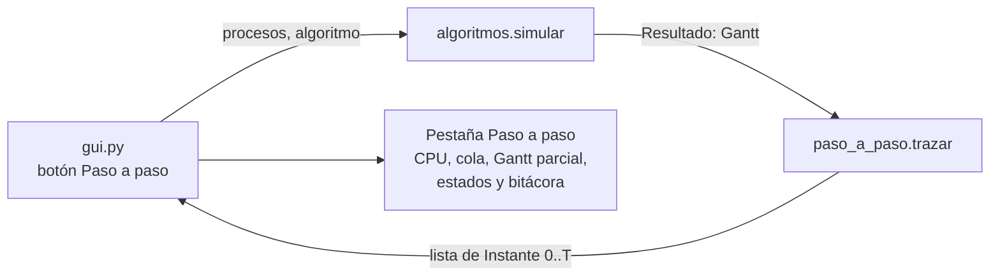
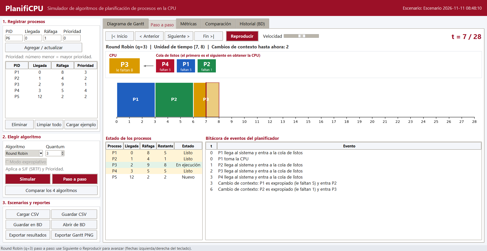

# Componente: modo paso a paso

**Fase II · PlanifiCPU · Grupo G11**

## 1. Propósito

En la Fase I el simulador mostraba el resultado final (Gantt completo y métricas). El modo paso a paso muestra **cómo llega el planificador a ese resultado**: en cada unidad de tiempo se ve qué proceso tiene la CPU, cómo está ordenada la cola de listos, cuánto le falta a cada proceso, su estado y qué eventos ocurrieron (llegadas, despachos, expropiaciones, cambios de contexto y terminaciones).

Atiende la necesidad del docente de mostrar en clase la ejecución paso a paso (sección 3 del README) y es el primer pendiente que dejó la Fase I.

## 2. Archivos

| Archivo | Capa | Qué hace |
|---|---|---|
| `src/codigo_fuente/planificpu/paso_a_paso.py` | Lógica | Clase `Instante` y función `trazar(procesos, resultado)`. No usa Tkinter. |
| `src/codigo_fuente/planificpu/gui.py` | Presentación | Pestaña **Paso a paso**, botón **Paso a paso** y reproducción automática. |
| `pruebas/test_paso_a_paso.py` | Pruebas | 14 pruebas del componente. |

## 3. Diseño

`trazar` **no vuelve a planificar**: toma el Gantt que produjo el motor (única fuente de verdad) y lo expande unidad por unidad. Así el paso a paso nunca puede contradecir al Gantt ni a las métricas.

### Estructura `Instante`

| Campo | Tipo | Significado |
|---|---|---|
| `t` | `int` | Instante; representa la unidad de tiempo `[t, t+1)`. |
| `en_cpu` | `str` o `None` | Proceso en ejecución (`None` = CPU ociosa). |
| `cola` | `list[str]` | Cola de listos, sin el proceso en CPU. |
| `restante` | `dict[str, int]` | Ráfaga pendiente de cada proceso al inicio de `t`. |
| `estados` | `dict[str, str]` | Nuevo, Listo, En ejecución o Terminado. |
| `eventos` | `list[str]` | Lo que ocurrió en `t`, en el lenguaje del curso. |
| `cambios_contexto` | `int` | Cambios de contexto acumulados hasta `t`. |

Se genera un instante por cada unidad de tiempo y uno final (`t = tiempo total`) en el que todos los procesos están terminados.

### Orden de la cola de listos

| Algoritmo | Orden mostrado | Por qué |
|---|---|---|
| FCFS | Por llegada y orden de registro | Es el orden en que el planificador los atenderá. |
| SJF / SRTF | Por ráfaga restante, luego llegada | El primero es el siguiente en obtener la CPU. |
| Prioridad | Por número de prioridad (menor = mayor), luego llegada | Igual que el motor. |
| Round Robin | Orden real de la cola FIFO | Se reproduce la cola respetando que las llegadas durante un quantum entran antes que el proceso expropiado. |

Para FCFS, SJF y Prioridad se usa la misma clave de selección del motor (`algoritmos._CLAVES`), por lo que la regla de desempate es idéntica.

### Eventos que se registran

| Evento | Cuándo |
|---|---|
| `P2 llega al sistema y entra a la cola de listos` | `t` es igual a la llegada del proceso. |
| `P1 toma la CPU` | Primer despacho de la simulación. |
| `Cambio de contexto: P1 -> P2` | La CPU pasa a otro proceso porque el anterior terminó (también después de un tramo ocioso). |
| `Cambio de contexto: P1 es expropiado (le faltan 7) y entra P2` | Expropiación en SRTF, Prioridad expropiativa o fin de quantum en Round Robin. |
| `Quantum agotado: P1 sigue en la CPU porque la cola está vacía` | Round Robin sin otros procesos listos. |
| `P1 termina su ráfaga y sale del sistema` | El proceso completó su ráfaga. |
| `CPU ociosa: no hay procesos en la cola de listos` | Inicio de un tramo sin procesos listos. |

El conteo de cambios de contexto sigue la misma regla de la Fase I (la CPU pasa a un proceso distinto del último que la usó; el ocio no cuenta), y una prueba verifica que el valor final coincide con `Resultado.cambios_contexto`.

## 4. Uso en la interfaz

1. Registre o cargue los procesos y elija el algoritmo.
2. Pulse **Paso a paso** (panel 2). La simulación se guarda en el historial igual que con **Simular**.
3. Avance con **Siguiente >**, **< Anterior**, **|< Inicio**, **Fin >|** o las flechas del teclado.
4. **Reproducir** avanza solo; la barra **Velocidad** ajusta el tiempo entre pasos.

La pestaña también se actualiza al pulsar **Simular** o **Comparar** (muestra el algoritmo elegido).

## 5. Decisiones técnicas

| Decisión | Alternativa descartada | Motivo |
|---|---|---|
| Reconstruir desde el Gantt | Instrumentar cada algoritmo para que guarde su estado | Una sola fuente de verdad; el motor de la Fase I no cambia y sus 13 pruebas siguen valiendo. |
| Granularidad de 1 unidad | Un paso por evento | Coincide con la forma en que se resuelven los ejercicios en papel. |
| Copia de los procesos al preparar la traza | Leer la tabla de procesos en vivo | Si el usuario edita la tabla, la traza ya generada no se rompe. |
| Lógica sin Tkinter | Calcular en la interfaz | Se puede probar con `unittest` sin abrir ventanas (RNF04). |
