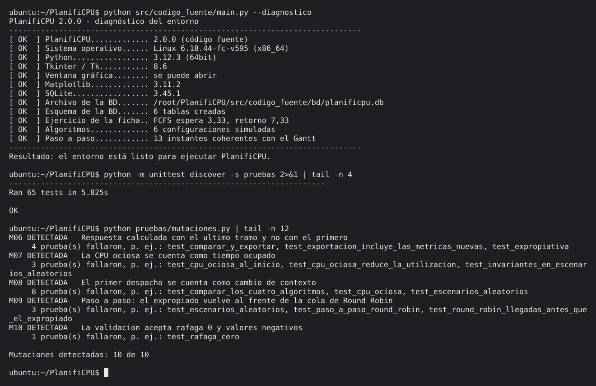

# Configuración del sistema operativo y del entorno · Fase III

**PlanifiCPU v2.0.0 · Grupo G11**

PlanifiCPU se puede usar de dos formas: con el **ejecutable** (`PlanifiCPU.exe`, no necesita Python) o desde el **código fuente**. Esta guía explica cómo dejar listo el equipo en cada caso, cómo comprobar que quedó bien y en qué entornos se probó.

## 1. Entornos en los que se probó

| Entorno | Sistema operativo | Python | Qué se ejecutó |
|---|---|---|---|
| Desarrollo del equipo (Fases I y II) | Windows 11, 64 bits | 3.14.6 | Aplicación, 27 pruebas, capturas de las Fases I y II |
| Versión final (Fase III) | Ubuntu 24.04, x86_64, pantalla virtual Xvfb | 3.12.3 | Aplicación, 65 pruebas, mutaciones, análisis de resultados, ejecutable con PyInstaller, capturas de `recursos/imagenes/version_final/` |
| Integración continua (GitHub Actions) | `windows-latest` y `ubuntu-latest` | 3.12 y 3.13 | Diagnóstico, 65 pruebas, mutaciones y modo consola en cada `push` a `main` |
| Ejecutable (GitHub Actions) | `windows-latest` | 3.12 | Construcción de `PlanifiCPU.exe` y su diagnóstico |

## 2. Requisitos

| Elemento | Mínimo | Recomendado |
|---|---|---|
| Sistema operativo | Windows 10 de 64 bits | Windows 11 de 64 bits (también funciona en Linux y macOS con Python) |
| Procesador | Doble núcleo de 1,6 GHz | Cualquier equipo actual |
| Memoria RAM | 4 GB | 8 GB |
| Disco | 500 MB (Python y librerías) o 60 MB (solo el .exe) | |
| Pantalla | 1366 × 768 | 1920 × 1080 |
| Python (solo código fuente) | 3.10 | 3.12 o superior, con Tkinter y SQLite |
| Librerías | Matplotlib 3.8 | Matplotlib 3.11 |

No se necesita servidor, conexión a internet, máquina virtual ni permisos de administrador.

## 3. Opción A: ejecutable de Windows (sin instalar Python)

1. Descargue `PlanifiCPU.exe` de la sección **Releases** del repositorio (o de la pestaña *Actions* → *Ejecutable de Windows* → artefacto `PlanifiCPU-windows`).
2. Ábralo con doble clic. Si Windows SmartScreen muestra "Windows protegió su PC", pulse **Más información → Ejecutar de todas formas** (el ejecutable no está firmado digitalmente).
3. La base de datos se crea sola en `%APPDATA%\PlanifiCPU\planificpu.db` (por ejemplo `C:\Users\ana\AppData\Roaming\PlanifiCPU\`). Así el historial se conserva entre usos, aunque el .exe se mueva de carpeta.

### Generar el ejecutable

En Windows, con Python instalado, haga doble clic en [`empaquetado/empaquetar_windows.bat`](../../empaquetado/empaquetar_windows.bat). El script crea un entorno virtual, instala las dependencias y PyInstaller, corre las pruebas, construye `dist\PlanifiCPU.exe` y lo verifica con `--diagnostico`. A mano:

```bat
python -m venv .venv-empaquetado
.venv-empaquetado\Scripts\activate
python -m pip install -r requirements.txt pyinstaller
pyinstaller --noconfirm --clean empaquetado\PlanifiCPU.spec
dist\PlanifiCPU.exe
```

La receta está en [`empaquetado/PlanifiCPU.spec`](../../empaquetado/PlanifiCPU.spec): incluye Python, Tkinter, Matplotlib, el esquema `schema.sql` y el icono, y usa `console=False` para que no se abra la ventana negra de la consola.

**Publicar una versión.** Al subir una etiqueta que empiece por `v`, GitHub Actions construye el .exe y lo adjunta a la versión en *Releases*:

```bash
git tag v2.0.0
git push origin v2.0.0
```

## 4. Opción B: código fuente en Windows 10/11

### 4.1 Instalar Python

1. Descargue Python 3.12 o superior de <https://www.python.org/downloads/windows/> (instalador de 64 bits).
2. En la primera pantalla marque **Add python.exe to PATH**.
3. En *Customize installation* deje marcadas **tcl/tk and IDLE** (Tkinter) y **pip**.
4. Compruebe en una terminal (PowerShell o CMD):

```bat
python --version
python -m tkinter
```

La segunda orden abre una ventanita de Tk; si da error, reinstale Python marcando *tcl/tk*.

### 4.2 Descargar el proyecto e instalar dependencias

```bat
git clone https://github.com/daviid0611/PlanifiCPU_SistemasOperativos_G11.git
cd PlanifiCPU_SistemasOperativos_G11
python -m venv .venv
.venv\Scripts\activate
python -m pip install -r requirements.txt
```

El entorno virtual (`.venv`) es opcional pero evita mezclar librerías con otros proyectos; la carpeta está en `.gitignore`. Si PowerShell bloquea `activate`, ejecute una vez `Set-ExecutionPolicy -Scope CurrentUser RemoteSigned`.

### 4.3 Ejecutar

```bat
python src\codigo_fuente\main.py
```

`main.py` activa `SetProcessDpiAwareness(1)` para que el texto se vea nítido en pantallas con escalado (125 %, 150 %). La primera vez se crea `src\codigo_fuente\bd\planificpu.db` a partir de `schema.sql`.

## 5. Opción C: código fuente en Linux o macOS

```bash
# Ubuntu / Debian: Tkinter viene en un paquete aparte
sudo apt install python3 python3-venv python3-tk
# macOS: el instalador de python.org ya incluye Tkinter

git clone https://github.com/daviid0611/PlanifiCPU_SistemasOperativos_G11.git
cd PlanifiCPU_SistemasOperativos_G11
python3 -m venv .venv
source .venv/bin/activate
python -m pip install -r requirements.txt
python src/codigo_fuente/main.py
```

En un servidor sin pantalla se puede usar el **modo consola** (`--consola`) o una pantalla virtual: `xvfb-run python src/codigo_fuente/main.py`.

## 6. Verificar el entorno

```bash
python src/codigo_fuente/main.py --diagnostico
```

Revisa el sistema operativo, Python, Tkinter (y si se puede abrir una ventana), Matplotlib, SQLite, que la carpeta de la base de datos permita escribir y que el esquema cree las 6 tablas; luego simula el ejercicio de la ficha técnica con las 6 configuraciones y el modo paso a paso. Termina con código 0 si todo está bien y 1 si algo falla. Salida de ejemplo en [evidencias/diagnostico.txt](evidencias/diagnostico.txt).



Después se pueden correr las pruebas:

```bash
python -m unittest discover -s pruebas -v
```

## 7. Variables y archivos de configuración

| Elemento | Para qué sirve |
|---|---|
| `requirements.txt` | Única dependencia externa: `matplotlib>=3.8`. Tkinter, SQLite, csv y unittest vienen con Python. |
| `src/codigo_fuente/bd/schema.sql` | Esquema de la base de datos; se aplica solo con `CREATE TABLE IF NOT EXISTS`. |
| `PLANIFICPU_BD` (variable de entorno) | Ruta alternativa para la base de datos, útil en pruebas o para tener varios historiales. Ejemplo: `set PLANIFICPU_BD=D:\clase\historial.db`. |
| `.gitignore` | Excluye la base de datos local, entornos virtuales y las carpetas `build/` y `dist/` de PyInstaller. |
| `.gitattributes` | Guarda los `.bat` con fin de línea de Windows y excluye los HTML de diagramas de las estadísticas de lenguajes. |
| `.github/workflows/pruebas.yml` | Pruebas en Windows y Ubuntu con Python 3.12 y 3.13. |
| `.github/workflows/ejecutable-windows.yml` | Construcción y publicación del .exe. |

## 8. Problemas frecuentes

| Síntoma | Causa | Solución |
|---|---|---|
| `ModuleNotFoundError: No module named 'tkinter'` | Python instalado sin Tcl/Tk | Windows: reinstalar marcando *tcl/tk*. Ubuntu: `sudo apt install python3-tk`. |
| `ModuleNotFoundError: No module named 'matplotlib'` | Falta instalar dependencias o el entorno virtual no está activo | `python -m pip install -r requirements.txt` con el `.venv` activado. |
| `'python' no se reconoce como un comando` | Python no está en el PATH | Reinstalar marcando *Add python.exe to PATH* o usar `py` en lugar de `python`. |
| Texto borroso en Windows | Escalado de pantalla | Ejecutar `main.py` (ya activa el modo DPI); no abrir `gui.py` directamente. |
| `no display name and no $DISPLAY` | Linux sin pantalla | Usar `--consola` o `xvfb-run`. |
| SmartScreen bloquea el .exe | Ejecutable sin firma digital | *Más información → Ejecutar de todas formas*. |
