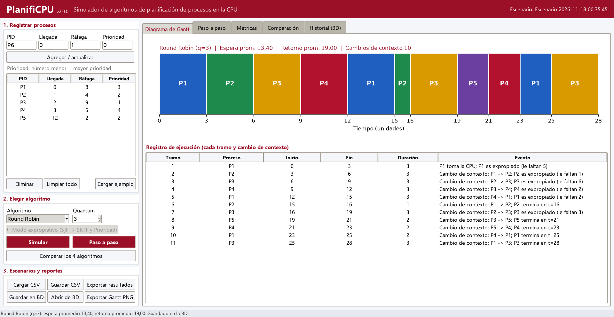
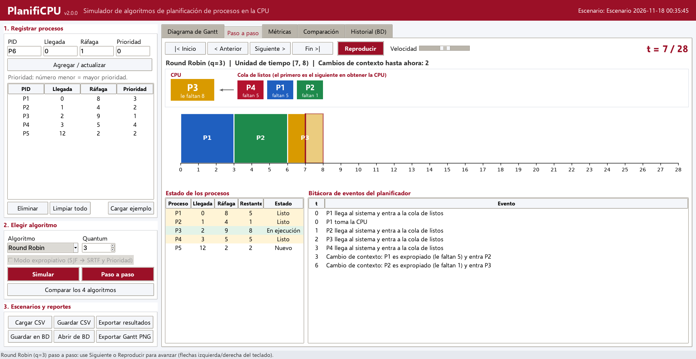
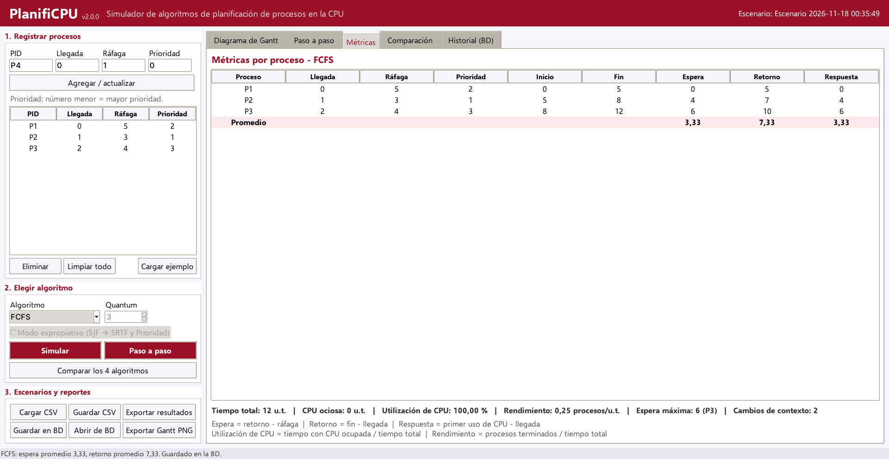
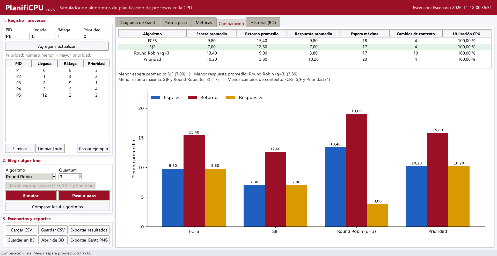
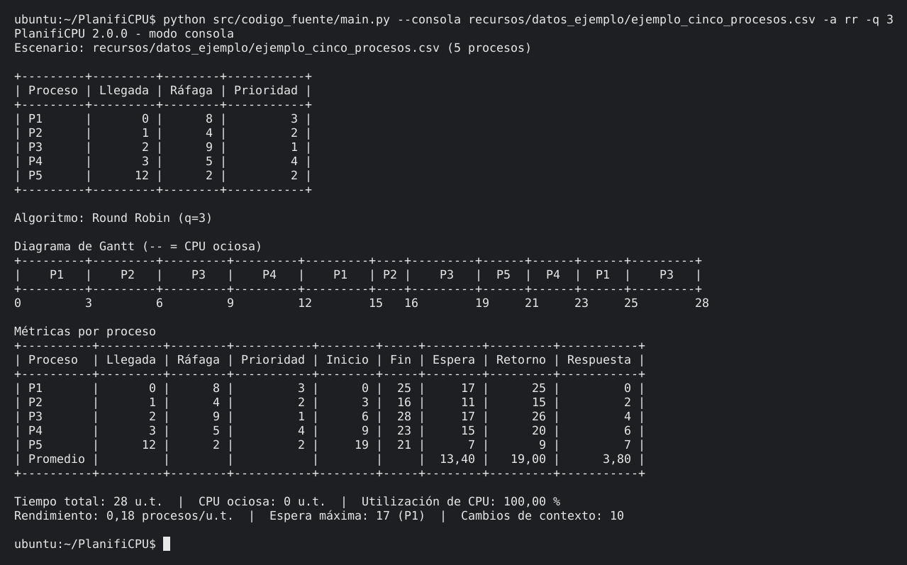
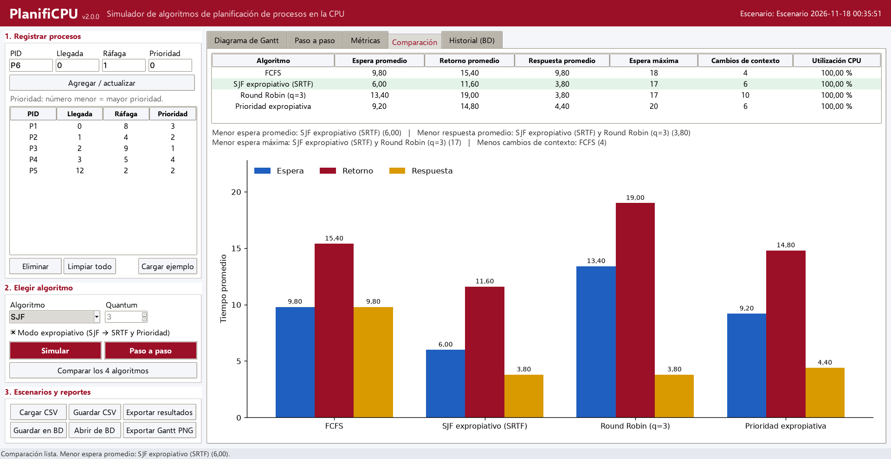

# Manual de usuario · PlanifiCPU v2.0.0

**Simulador de algoritmos de planificación de procesos en la CPU · Grupo G11 · Universidad Manuela Beltrán**

Este manual explica cómo usar PlanifiCPU para resolver y comprobar ejercicios de planificación de CPU. Para instalarlo vea [configuracion_entorno.md](configuracion_entorno.md).

## 1. Abrir la aplicación

- **Ejecutable:** doble clic en `PlanifiCPU.exe`.
- **Código fuente:** `python src/codigo_fuente/main.py` desde la carpeta del repositorio.

La ventana se abre maximizada. A la izquierda están los tres pasos de trabajo; a la derecha, las cinco pestañas de resultados. Abajo, la barra de estado confirma cada acción.



## 2. Paso 1: registrar los procesos

| Campo | Qué escribir | Regla |
|---|---|---|
| PID | Nombre del proceso (P1, A, CPU1…) | Obligatorio y sin repetir |
| Llegada | Instante en que el proceso entra al sistema | Entero ≥ 0 |
| Ráfaga | Unidades de CPU que necesita | Entero ≥ 1 |
| Prioridad | Solo para el algoritmo por prioridad | Entero ≥ 0; **número menor = prioridad mayor** |

- **Agregar / actualizar:** agrega el proceso; si el PID ya existe, lo reemplaza.
- **Editar:** haga clic en una fila de la tabla; sus datos pasan a los campos. Cambie lo necesario y pulse *Agregar / actualizar*.
- **Eliminar:** borra la fila seleccionada. **Limpiar todo:** vacía la tabla.
- **Cargar ejemplo:** carga el ejercicio de la ficha técnica (P1, P2, P3).

Si un dato no es válido aparece un mensaje que explica qué corregir y el proceso no se agrega.

## 3. Paso 2: elegir el algoritmo

| Algoritmo | Cómo decide | Opciones |
|---|---|---|
| FCFS | Atiende por orden de llegada | – |
| SJF | Elige la ráfaga más corta | *Modo expropiativo* = SRTF (menor tiempo restante) |
| Round Robin | Turnos de duración fija en cola circular | *Quantum* (1 a 50) |
| Prioridad | Elige el de número de prioridad menor | *Modo expropiativo* |

Las opciones que no aplican al algoritmo elegido se desactivan solas. Luego pulse:

- **Simular:** calcula el Gantt y las métricas y abre la pestaña *Diagrama de Gantt*.
- **Paso a paso:** igual que *Simular*, pero abre la pestaña *Paso a paso* en t = 0.
- **Comparar los 4 algoritmos:** corre FCFS, SJF, Round Robin (con el quantum indicado) y Prioridad con los mismos procesos. Si *Modo expropiativo* está marcado, SJF y Prioridad se comparan en su versión expropiativa.

Cada simulación se guarda en el historial. Si el escenario no tiene nombre, se guarda con la fecha y hora.

**Reglas de desempate** (las mismas del curso): gana el que llegó primero y, si llegaron igual, el que se registró primero. En modo expropiativo, ante un empate sigue el proceso que ya está en la CPU. En Round Robin, los procesos que llegan durante un quantum entran a la cola antes que el proceso expropiado.

## 4. Leer los resultados

### 4.1 Diagrama de Gantt

Muestra cada tramo de ejecución con su proceso; los tramos con rayas son CPU ociosa. El título resume la espera y el retorno promedio y los cambios de contexto. Debajo, el **registro de ejecución** describe cada tramo: quién toma la CPU, cada cambio de contexto, cada expropiación (con cuánto le falta al proceso) y cuándo termina cada uno.

### 4.2 Paso a paso



Recorre la simulación unidad por unidad de tiempo:

| Control | Acción |
|---|---|
| `|< Inicio` / `Fin >|` | Ir a t = 0 o al final |
| `< Anterior` / `Siguiente >` | Retroceder o avanzar una unidad (también con las flechas ← y → del teclado) |
| `Reproducir` / `Pausa` | Avanza solo; la barra *Velocidad* ajusta el ritmo |

En cada instante se ve el proceso en la **CPU** y cuánto le falta, la **cola de listos** en el orden en que el planificador los atenderá, el **Gantt** construyéndose, el **estado** de cada proceso (Nuevo, Listo, En ejecución, Terminado) y la **bitácora** de eventos hasta ese momento.

### 4.3 Métricas



| Métrica | Fórmula | Qué indica |
|---|---|---|
| Espera | retorno − ráfaga | Tiempo en la cola de listos |
| Retorno | fin − llegada | Tiempo total en el sistema |
| Respuesta | primer uso de CPU − llegada | Cuánto tarda en ser atendido por primera vez |
| Utilización de CPU | tiempo ocupado / tiempo total × 100 | Porcentaje del tiempo que la CPU trabajó |
| Rendimiento | procesos terminados / tiempo total | Procesos completados por unidad de tiempo |
| Espera máxima | mayor espera de un proceso | Revela si algún proceso sufrió **inanición** |
| Cambios de contexto | veces que la CPU pasa a otro proceso | Costo extra de expropiar |

La tabla muestra las tres primeras por proceso y sus promedios; la línea de resumen, debajo, muestra el resto.

### 4.4 Comparación



La tabla resalta en verde el algoritmo con menor espera promedio y, debajo, indica cuál gana en cada métrica. La gráfica compara espera, retorno y respuesta promedio.

### 4.5 Historial (BD)

Lista todas las simulaciones guardadas, de la más reciente a la más antigua. Seleccione una y pulse **Abrir escenario de la simulación seleccionada** para volver a cargar sus procesos. **Actualizar** recarga la lista.

## 5. Paso 3: escenarios y reportes

| Botón | Qué hace |
|---|---|
| Cargar CSV | Carga procesos desde un archivo CSV |
| Guardar CSV | Guarda la tabla de procesos en CSV |
| Exportar resultados | Guarda en CSV las métricas, el Gantt y, si se comparó, la tabla comparativa |
| Guardar en BD | Guarda el escenario con un nombre |
| Abrir de BD | Lista los escenarios guardados para abrir o eliminar uno (al eliminarlo se borran sus simulaciones) |
| Exportar Gantt PNG | Guarda el diagrama de Gantt como imagen |

**Formato del CSV.** Separado por coma o por punto y coma (Excel en español). La columna `prioridad` es opcional.

```csv
pid;llegada;rafaga;prioridad
P1;0;5;2
P2;1;3;1
P3;2;4;3
```

**Escenarios incluidos** en `recursos/datos_ejemplo/`:

| Archivo | Para qué sirve |
|---|---|
| `ejemplo_ficha.csv` | Ejercicio de la ficha técnica (3 procesos) |
| `ejemplo_cinco_procesos.csv` | Ejercicio de la Fase II con llegadas escalonadas |
| `stallings.csv` | Procesos A–E de Stallings, tabla 9.5 |
| `silberschatz_prioridad.csv` | Ejemplo de prioridad de Silberschatz (espera promedio 8,2) |
| `efecto_convoy.csv` | Un proceso largo delante de cuatro cortos |
| `interactivos_vs_cpu.csv` | Procesos interactivos cortos frente a procesos de CPU largos |
| `inanicion.csv` | Un proceso de baja prioridad y una serie de procesos prioritarios |

## 6. Modo consola

Para revisar un ejercicio rápido desde la terminal, sin abrir la ventana:

```bash
python src/codigo_fuente/main.py --consola                                  # ejemplo de la ficha con FCFS
python src/codigo_fuente/main.py --consola mi_ejercicio.csv -a rr -q 3      # Round Robin q=3
python src/codigo_fuente/main.py --consola mi_ejercicio.csv -a srtf --traza # paso a paso en texto
python src/codigo_fuente/main.py --consola mi_ejercicio.csv --comparar --exportar resultados.csv
python src/codigo_fuente/main.py --help
```

| Opción | Significado |
|---|---|
| `-a`, `--algoritmo` | `fcfs`, `sjf`, `srtf`, `rr` (o `round-robin`), `prioridad`, `prioridad-exp` |
| `-q`, `--quantum` | Quantum de Round Robin (por defecto 2) |
| `-e`, `--expropiativo` | Modo expropiativo para SJF y Prioridad |
| `--comparar` | Corre los 4 algoritmos y dice cuál gana en cada métrica |
| `--traza` | Imprime cada instante con la CPU, la cola de listos y los eventos |
| `--exportar RUTA.csv` | Guarda los resultados en CSV |



El modo consola no guarda en la base de datos. Si hay un error en los datos, muestra el motivo y termina con código 2.

## 7. Otras opciones

| Orden | Para qué |
|---|---|
| `python src/codigo_fuente/main.py --diagnostico` | Revisa que el equipo tenga todo lo necesario (ver [configuracion_entorno.md](configuracion_entorno.md)) |
| `python src/codigo_fuente/main.py --version` | Muestra la versión |
| `python src/codigo_fuente/analisis_resultados.py` | Regenera las tablas y gráficas de [resultados.md](resultados.md) |

## 8. Ejercicio guiado

Objetivo: ver por qué Round Robin responde rápido pero espera más.

1. Pulse **Cargar CSV** y abra `recursos/datos_ejemplo/ejemplo_cinco_procesos.csv`.
2. Elija **Round Robin**, quantum **3**, y pulse **Paso a paso**.
3. Avance con → hasta t = 7: P3 está en la CPU y la cola es P4, P1, P2. P1 ya usó su quantum y volvió a la cola detrás de P4, que llegó en t = 3 justo cuando P1 fue expropiado.
4. Pulse **Comparar los 4 algoritmos**. Round Robin tiene la mejor respuesta promedio (3,80) pero la peor espera promedio (13,40) y 10 cambios de contexto, frente a 4 de FCFS.
5. Marque **Modo expropiativo**, elija **SJF** y vuelva a comparar: SRTF baja la espera promedio a 6,00 sin perder la respuesta (3,80).


