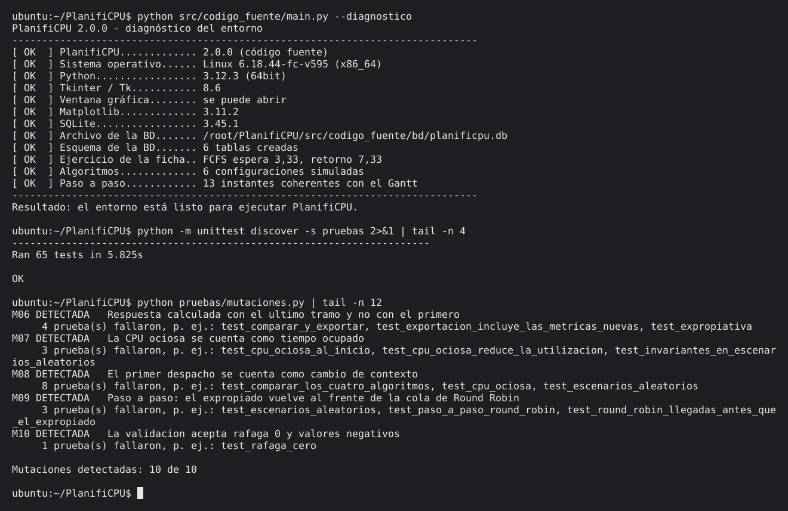

# Pruebas de funcionamiento · Fase III (versión final)

**PlanifiCPU v2.0.0 · Grupo G11**

## 1. Resumen

| Tipo de prueba | Qué comprueba | Cantidad | Resultado |
|---|---|---|---|
| Unitarias del motor (Fase I) | Algoritmos con ejercicios de resultado conocido, validación, CSV y BD | 13 | 13 OK |
| Paso a paso (Fase II) | Cola de listos, estados, eventos y 420 simulaciones aleatorias | 14 | 14 OK |
| Validación con la bibliografía | Tablas publicadas por Stallings y Tanenbaum | 5 | 5 OK |
| Propiedades del planificador | Reglas de la teoría en miles de simulaciones aleatorias | 9 | 9 OK |
| Versión final | Métricas nuevas, consola, diagnóstico, BD del .exe, análisis y rendimiento | 17 | 17 OK |
| Interfaz gráfica | La ventana real: simular, comparar, paso a paso, validación, exportar y BD | 7 | 7 OK |
| **Total automáticas** | | **65** | **65 OK** |
| Mutación | Errores introducidos a propósito que las pruebas deben detectar | 10 | 10 detectadas |
| Manuales | Recorrido de la interfaz y del ejecutable | 12 | 12 OK |

```bash
python -m unittest discover -s pruebas -v     # 65 pruebas automáticas
python pruebas/mutaciones.py                  # 10 pruebas de mutación
python src/codigo_fuente/main.py --diagnostico
```

**Entorno de la ejecución registrada:** Ubuntu 24.04 (x86_64), Python 3.12.3, Tk 8.6, Matplotlib 3.11.2, SQLite 3.45.1, con pantalla virtual Xvfb para la interfaz. Salidas completas en [salida_pruebas.txt](salida_pruebas.txt) y [salida_mutaciones.txt](salida_mutaciones.txt). Las 27 pruebas de las Fases I y II también se ejecutaron en Windows 11 con Python 3.14.6 (ver [Fase II](../fase2/pruebas_fase2.md)).

**Integración continua:** el flujo [`.github/workflows/pruebas.yml`](../../.github/workflows/pruebas.yml) repite las 65 pruebas, el diagnóstico, las mutaciones y el modo consola en **Windows y Ubuntu con Python 3.12 y 3.13** cada vez que se sube un cambio a `main`. El resultado de cada ejecución queda en la pestaña *Actions* del repositorio y en la insignia del README.



## 2. Validación con la bibliografía (`test_validacion_bibliografia.py`)

Los valores esperados se copiaron de los libros del curso, no del simulador.

| # | Prueba | Fuente | Qué verifica | Resultado |
|---|---|---|---|---|
| 1 | `test_tiempos_de_fin_y_retorno` | Stallings, tabla 9.5 | Fin y retorno de A–E con FCFS (8,60), RR q=1 (10,80), RR q=4 (10,00), SPN (7,60) y SRT (7,20) | OK |
| 2 | `test_secuencia_round_robin_q1` | Stallings, tabla 9.5 | Orden unidad por unidad `AABABCBDCBEDCBEDCBDD` | OK |
| 3 | `test_secuencia_srt` | Stallings, tabla 9.5 | Orden `AAABCCCCEEBBBBBDDDDD` | OK |
| 4 | `test_fcfs` | Tanenbaum, sec. 2.4.3 | A=8, B=4, C=4, D=4: retornos 8, 12, 16, 20 (promedio 14) | OK |
| 5 | `test_sjf` | Tanenbaum, sec. 2.4.3 | Orden B, C, D, A y retorno promedio 11 | OK |

Con estas y las 13 de la Fase I (Silberschatz: SJF 7,0; SRTF 6,5; RR q=4 17/3; Prioridad 8,2) el motor queda validado contra **tres libros distintos**.

## 3. Propiedades del planificador (`test_propiedades.py`)

En lugar de un resultado escrito a mano, se generan cargas aleatorias con semilla fija y se comprueba que se cumplan reglas que valen para **cualquier** carga.

| # | Prueba | Cargas × configuraciones | Regla verificada | Resultado |
|---|---|---|---|---|
| 1 | `test_invariantes_en_escenarios_aleatorios` | 150 × 8 | El Gantt empieza en 0, sin huecos ni solapes; cada proceso recibe exactamente su ráfaga y nunca antes de llegar; **la CPU nunca está ociosa si hay procesos listos**; espera = retorno − ráfaga, respuesta ≤ espera; utilización y rendimiento según su fórmula; cambios de contexto ≥ n − 1 | OK |
| 2 | `test_no_expropiativos_ejecutan_cada_proceso_de_una_vez` | 150 × 3 | FCFS, SJF y Prioridad: un solo tramo por proceso, respuesta = espera y exactamente n − 1 cambios de contexto | OK |
| 3 | `test_expropiativos_respetan_la_regla_de_seleccion` | 150 × 2 | SRTF y Prioridad expropiativa: en cada unidad corre el de menor clave; empate → sigue el que está en CPU, luego el que llegó primero, luego el registrado primero | OK |
| 4 | `test_no_expropiativos_respetan_la_regla_de_seleccion` | 150 × 2 | SJF y Prioridad: al liberarse la CPU se elige la menor clave con los mismos desempates | OK |
| 5 | `test_fcfs_atiende_por_orden_de_llegada` | 100 | El orden de ejecución es el de llegada | OK |
| 6 | `test_round_robin_con_quantum_grande_es_fcfs` | 100 | Con q ≥ ráfaga máxima, Round Robin produce el mismo Gantt que FCFS | OK |
| 7 | `test_srtf_da_la_menor_espera_promedio` | 200 × 8 | **SRTF nunca es superado** en espera promedio (optimalidad, Silberschatz 5.3.2) | OK |
| 8 | `test_sjf_es_optimo_cuando_todos_llegan_juntos` | 40 | Se prueban **todos los órdenes posibles** (hasta 720) y ninguno da menor espera que SJF | OK |
| 9 | `test_cpu_ociosa_reduce_la_utilizacion` | 1 | Con 4 u.t. ociosas de 8, utilización 50 % y rendimiento 0,25 | OK |

## 4. Funciones de la versión final (`test_version_final.py`)

| # | Prueba | Qué verifica | Resultado |
|---|---|---|---|
| 1 | `test_ficha_tecnica` | Ficha FCFS: tiempo total 12, ocio 0, utilización 100 %, rendimiento 0,25, espera máxima 6 (P3) | OK |
| 2 | `test_round_robin_reparte_la_espera` | RR q=2: espera máxima 7 (P1) y 6 cambios de contexto | OK |
| 3 | `test_cpu_ociosa_al_inicio` | Un proceso que llega en t=4: ocio 4, utilización 50 % | OK |
| 4 | `test_exportacion_incluye_las_metricas_nuevas` | El CSV exportado trae utilización, rendimiento, espera máxima y el comparativo ampliado | OK |
| 5 | `test_simulacion_con_gantt_en_texto` | Modo consola: Gantt en texto, tabla de métricas y promedio 5,67 | OK |
| 6 | `test_srtf_y_traza` | `--traza`: en t=1 P2 expropia a P1 ("le faltan 7") | OK |
| 7 | `test_comparar_y_exportar` | `--comparar --exportar`: mejor en cada métrica y archivo CSV creado | OK |
| 8 | `test_cpu_ociosa_en_el_gantt_de_texto` | La CPU ociosa se dibuja como `--` con los tiempos correctos | OK |
| 9 | `test_errores_devuelven_codigo_2` | Archivo inexistente, CSV con texto y quantum 0 terminan con código 2 y mensaje en español | OK |
| 10 | `test_version` | `--version` imprime `PlanifiCPU 2.0.0` | OK |
| 11 | `test_entorno_listo` | `--diagnostico` devuelve 0 y revisa Python, SQLite, esquema, ejercicio de la ficha, algoritmos y paso a paso | OK |
| 12 | `test_reporta_falla` | Si un chequeo falla, el diagnóstico devuelve 1 | OK |
| 13 | `test_variable_de_entorno` | `PLANIFICPU_BD` cambia la ruta de la BD y la carpeta se crea sola | OK |
| 14 | `test_ejecutable_guarda_en_appdata` | Empaquetado como .exe, la BD va a `%APPDATA%\PlanifiCPU\planificpu.db` | OK |
| 15 | `test_codigo_fuente_guarda_junto_al_esquema` | Desde el código fuente, la BD sigue en `src/codigo_fuente/bd/` | OK |
| 16 | `test_genera_tablas_y_graficas` | El script de análisis genera las 5 gráficas, los CSV y el resumen; SRTF gana en el 100 % de las cargas | OK |
| 17 | `test_50_procesos_en_menos_de_un_segundo` | **RNF05**: 50 procesos (simulación + paso a paso) y la comparación de los 4 algoritmos en menos de 1 s | OK |

## 5. Interfaz gráfica (`test_interfaz.py`)

Abren la ventana real (oculta) y llaman a los mismos métodos que los botones; los diálogos de archivo se reemplazan por rutas temporales. Si el equipo no tiene pantalla, se omiten.

| # | Prueba | Acciones | Qué verifica | Resultado |
|---|---|---|---|---|
| 1 | `test_simular_ejemplo_de_la_ficha` | Cargar ejemplo → Simular | Tabla de métricas (3,33 / 7,33 / 3,33), resumen con utilización y espera máxima, registro de tramos, historial y barra de estado | OK |
| 2 | `test_comparar_los_cuatro_algoritmos` | Cargar CSV → RR q=3 → Comparar | 4 filas, fila de SJF resaltada, columnas nuevas, conclusión "Menor espera promedio: SJF (7,00)", 4 simulaciones en el historial | OK |
| 3 | `test_paso_a_paso_round_robin` | Paso a paso → ir a t=7 → Fin → Reproducir → Pausa | t = 7 / 28, CPU P3 y cola P4, P1, P2; estados; la traza sigue funcionando después de limpiar la tabla | OK |
| 4 | `test_validacion_de_datos` | Ráfaga 0, ráfaga "tres", Simular sin procesos | 3 mensajes de error y ningún proceso agregado | OK |
| 5 | `test_agregar_y_editar_proceso` | Agregar A y B, volver a agregar A | A se actualiza en lugar de duplicarse | OK |
| 6 | `test_exportar_csv_y_png` | Simular → Exportar resultados → Exportar Gantt PNG | El CSV trae las métricas nuevas y el PNG es una imagen válida | OK |
| 7 | `test_guardar_y_abrir_escenario_de_la_bd` | Guardar en BD → Limpiar → Abrir de BD | Se recuperan los 5 procesos y el nombre del escenario | OK |

## 6. Pruebas de mutación (`pruebas/mutaciones.py`)

Una prueba que nunca falla no demuestra nada. Para medir si las pruebas detectan errores reales, el script copia el proyecto, introduce **un error a propósito** y corre las 65 pruebas. Si alguna falla, la mutación queda detectada.

| # | Error introducido | Pruebas que fallaron | Resultado |
|---|---|---|---|
| M01 | En modo expropiativo, ante un empate se cambia de proceso | 1 | Detectada |
| M02 | En modo no expropiativo, el empate no se resuelve por llegada | 6 | Detectada |
| M03 | Round Robin: el expropiado entra antes que los que llegaron | 11 | Detectada |
| M04 | Round Robin: el quantum dura una unidad de más | 12 | Detectada |
| M05 | Prioridad invertida (número mayor = mayor prioridad) | 7 | Detectada |
| M06 | Respuesta calculada con el último tramo | 4 | Detectada |
| M07 | La CPU ociosa se cuenta como tiempo ocupado | 3 | Detectada |
| M08 | El primer despacho se cuenta como cambio de contexto | 8 | Detectada |
| M09 | Paso a paso: el expropiado vuelve al frente de la cola de RR | 3 | Detectada |
| M10 | La validación acepta ráfaga 0 y valores negativos | 1 | Detectada |

**10 de 10 mutaciones detectadas** (conteos de [salida_mutaciones.txt](salida_mutaciones.txt), con la interfaz incluida). La M01 solo la detectó una prueba nueva de la Fase III (`test_expropiativos_respetan_la_regla_de_seleccion`): las pruebas anteriores no revisaban el desempate en modo expropiativo.

## 7. Pruebas manuales

| # | Acción | Resultado esperado | Resultado obtenido |
|---|---|---|---|
| F1 | Cargar ejemplo, FCFS, **Simular**, pestaña Métricas | Promedios 3,33 / 7,33 y la línea de resumen con utilización 100,00 % y espera máxima 6 (P3) | OK ([captura](../../recursos/imagenes/version_final/03_metricas.png)) |
| F2 | Cargar `ejemplo_cinco_procesos.csv`, RR q=3, **Comparar** | Columnas *Espera máxima* y *Utilización CPU*, SJF resaltado y conclusión por métrica | OK ([captura](../../recursos/imagenes/version_final/04_comparacion.png)) |
| F3 | Mismo escenario, SJF + **Modo expropiativo**, **Comparar** | Aparecen SRTF y Prioridad expropiativa; SRTF tiene la menor espera (6,00) | OK ([captura](../../recursos/imagenes/version_final/05_comparacion_expropiativa.png)) |
| F4 | `python src/codigo_fuente/main.py --consola ... -a rr -q 3` | Gantt en texto y métricas iguales a la interfaz (espera 13,40) | OK ([captura](../../recursos/imagenes/version_final/08_modo_consola.png)) |
| F5 | `--comparar` y `--traza` con `stallings.csv` | Tabla comparativa y eventos de SRTF unidad por unidad | OK ([captura](../../recursos/imagenes/version_final/09_consola_comparacion_y_traza.png)) |
| F6 | `--diagnostico` | Todos los chequeos en OK y código de salida 0 | OK ([captura](../../recursos/imagenes/version_final/10_diagnostico_y_pruebas.png)) |
| F7 | Construir el ejecutable con `pyinstaller empaquetado/PlanifiCPU.spec` (Linux) y correr `dist/PlanifiCPU --diagnostico` | Diagnóstico "(ejecutable)" en OK y BD en la carpeta del usuario | OK |
| F8 | Abrir `dist/PlanifiCPU` | Se abre la ventana con el icono y se crea la BD en la carpeta del usuario | OK |
| F9 | Cargar `inanicion.csv`, Prioridad, **Simular** y **Comparar** (q=3) | Prioridad y SJF tienen la menor espera promedio (1,57) pero la mayor espera máxima: BAJA espera 11; con FCFS y RR la espera máxima es 3 | OK ([captura](../../recursos/imagenes/version_final/06_inanicion_metricas.png)) |
| F10 | Cargar `efecto_convoy.csv` y **Comparar** con q=3 | FCFS y Prioridad con espera 17,00; Round Robin 5,00 | OK |
| F11 | Pantalla de 1366 × 768 al 100 % de escala (área útil 1366 × 698) | Los tres paneles, 5 filas de la tabla de procesos y la barra de estado quedan visibles; la conclusión de la comparación se parte en líneas | OK |
| F12 | Pestañas de las Fases I y II (Gantt, Paso a paso, Historial) | Siguen funcionando igual | OK |

## 8. Trazabilidad de requerimientos

| Requerimiento | Pruebas que lo cubren |
|---|---|
| RF01 Registrar, editar y eliminar procesos | `test_agregar_y_editar_proceso`, `test_paso_a_paso_round_robin` (limpiar) |
| RF02 Validar los datos | `test_pid_repetido`, `test_rafaga_cero`, `test_validacion_de_datos`, `test_errores_devuelven_codigo_2`, M10 |
| RF03 Elegir algoritmo | `test_algoritmos.py`, `test_validacion_bibliografia.py`, `test_propiedades.py` |
| RF04 Modo expropiativo | `test_expropiativo_srtf`, `test_expropiativa`, `test_expropiativos_respetan_la_regla_de_seleccion`, `test_srtf_da_la_menor_espera_promedio` |
| RF05 Gantt y cambios de contexto | `test_invariantes_en_escenarios_aleatorios`, `test_secuencia_*`, `test_simulacion_con_gantt_en_texto`, `test_paso_a_paso.py` |
| RF06 Métricas por proceso y promedios | `test_tiempos_de_fin_y_retorno`, `test_ficha_tecnica`, `test_simular_ejemplo_de_la_ficha` |
| RF07 Comparar los 4 algoritmos | `test_comparar_los_cuatro_algoritmos`, `test_comparar_y_exportar` |
| RF08 CSV y PNG | `test_csv_ida_y_vuelta`, `test_exportacion_incluye_las_metricas_nuevas`, `test_exportar_csv_y_png` |
| RF09 Base de datos e historial | `test_bd_guarda_escenario_y_simulacion`, `test_guardar_y_abrir_escenario_de_la_bd`, `test_variable_de_entorno` |
| RNF01 Portabilidad | Pruebas en Windows y Linux (CI), `test_ejecutable_guarda_en_appdata`, F7–F8 |
| RNF03 Exactitud | Validación con tres libros, propiedades y mutaciones |
| RNF04 Mantenibilidad | El motor se prueba sin abrir la ventana; la interfaz tiene sus propias pruebas |
| RNF05 Rendimiento | `test_50_procesos_en_menos_de_un_segundo`, experimento E6 de [resultados.md](resultados.md) |
| RNF06 Integridad de datos | `test_bd_guarda_escenario_y_simulacion` (borrado en cascada), `test_entorno_listo` (esquema) |
| RNF07 Control de versiones | Flujo de GitHub Actions en cada `push` |
