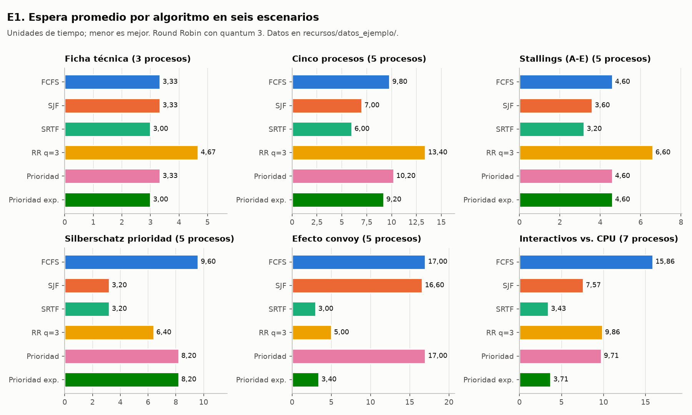
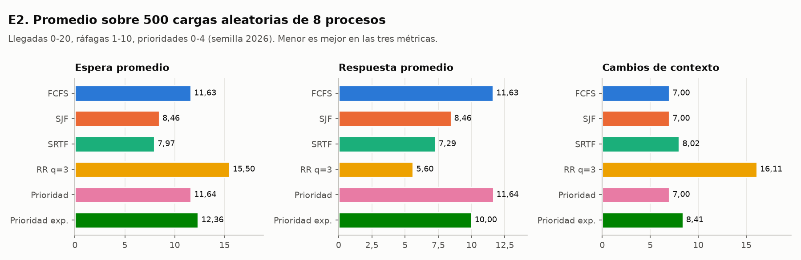
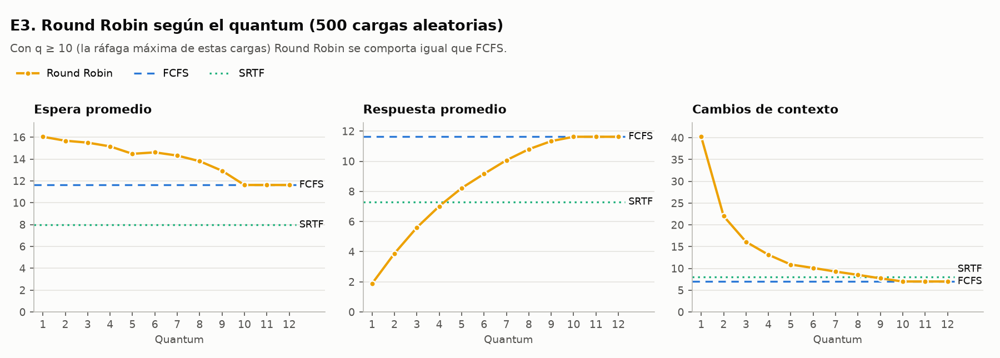
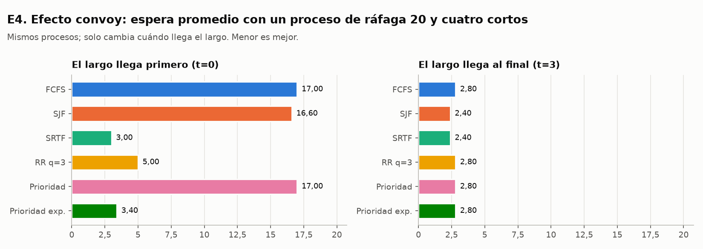
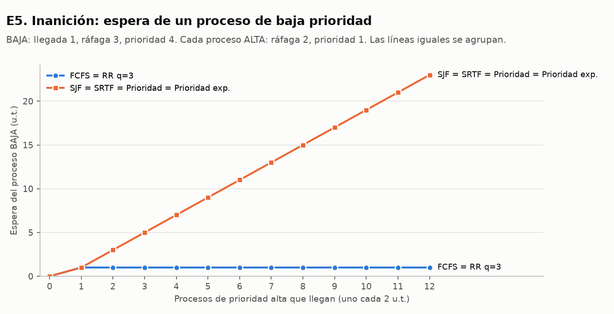

# Resultados obtenidos · Fase III

**PlanifiCPU v2.0.0 · Grupo G11**

Este documento usa el simulador para responder, con datos, las preguntas que el curso plantea sobre planificación de CPU: qué algoritmo conviene en cada caso, qué cuesta cada uno y en qué condiciones falla.

## 1. Cómo se obtuvieron

Todos los resultados salen del mismo motor de la aplicación (`planificpu.algoritmos.simular`) mediante el script [`src/codigo_fuente/analisis_resultados.py`](../../src/codigo_fuente/analisis_resultados.py):

```bash
python src/codigo_fuente/analisis_resultados.py
```

El script genera los archivos de la carpeta [`resultados/`](resultados): un CSV por experimento (se abre en Excel con punto y coma y coma decimal), las gráficas PNG y [`resumen.txt`](resultados/resumen.txt) con todas las tablas. Las cargas aleatorias usan la semilla 2026, así que al volver a correrlo se obtienen los mismos números (salvo los tiempos de ejecución del experimento E6, que dependen del equipo).

| Configuración | Algoritmo del motor |
|---|---|
| FCFS | FCFS |
| SJF | SJF no expropiativo |
| SRTF | SJF expropiativo |
| RR q=3 | Round Robin con quantum 3 |
| Prioridad | Prioridad no expropiativa (número menor = mayor prioridad) |
| Prioridad exp. | Prioridad expropiativa |

Los escenarios de ejemplo están en [`recursos/datos_ejemplo/`](../../recursos/datos_ejemplo) y se pueden abrir en la aplicación con **Cargar CSV**.

## 2. E1. Comparación en seis escenarios



| Escenario | Procesos | Menor espera promedio | Mayor espera promedio |
|---|---|---|---|
| Ficha técnica | 3 | SRTF y Prioridad exp. (3,00) | RR q=3 (4,67) |
| Cinco procesos (Fase II) | 5 | SRTF (6,00) | RR q=3 (13,40) |
| Stallings (A–E) | 5 | SRTF (3,20) | RR q=3 (6,60) |
| Silberschatz prioridad | 5 | SJF y SRTF (3,20) | FCFS (9,60) |
| Efecto convoy | 5 | SRTF (3,00) | FCFS y Prioridad (17,00) |
| Interactivos vs. CPU | 7 | SRTF (3,43) | FCFS (15,86) |

Detalle completo (retorno, respuesta, espera máxima, cambios de contexto y utilización) en [`e1_comparacion_escenarios.csv`](resultados/e1_comparacion_escenarios.csv).

**Lectura.** SRTF tiene la menor espera promedio en los seis escenarios. Round Robin, en cambio, tiene la mayor espera en tres de ellos, pero su tiempo de respuesta está entre los mejores (en *Cinco procesos* es 3,80, igual que SRTF, frente a 9,80 de FCFS). Los valores de Silberschatz (prioridad 8,20) y de Stallings (retorno FCFS 8,60, SJF 7,60 y SRTF 7,20) coinciden con los publicados en los libros.

## 3. E2. 500 cargas aleatorias

Para no sacar conclusiones de un solo ejemplo, se generaron 500 cargas de 8 procesos (llegadas 0–20, ráfagas 1–10, prioridades 0–4).



| Algoritmo | Espera prom. | Retorno prom. | Respuesta prom. | Espera máx. | Cambios ctx. | Cargas con la menor espera | Cargas con la menor respuesta |
|---|---|---|---|---|---|---|---|
| FCFS | 11,63 | 17,12 | 11,63 | 23,20 | 7,00 | 0,4 % | 0,0 % |
| SJF | 8,46 | 13,95 | 8,46 | 24,96 | 7,00 | 30,0 % | 2,8 % |
| **SRTF** | **7,97** | **13,46** | 7,29 | 25,15 | 8,02 | **100,0 %** | 22,0 % |
| RR q=3 | 15,50 | 20,99 | **5,60** | 25,37 | 16,11 | 0,0 % | **74,4 %** |
| Prioridad | 11,64 | 17,13 | 11,64 | 29,03 | 7,00 | 0,6 % | 0,0 % |
| Prioridad exp. | 12,36 | 17,85 | 10,00 | 30,10 | 8,41 | 0,2 % | 5,2 % |

Los porcentajes suman más de 100 % porque en una misma carga puede haber empates.

**Lectura.**

- **SRTF obtuvo la menor espera promedio en el 100 % de las cargas.** Es lo que predice la teoría: SRTF es óptimo para la espera promedio cuando se conocen las ráfagas (Silberschatz, sec. 5.3.2). La prueba `test_srtf_da_la_menor_espera_promedio` lo verifica en otras 200 cargas.
- **Round Robin da la mejor respuesta** (5,60, la mitad que FCFS) a cambio de la peor espera y retorno, y de más del doble de cambios de contexto (16,11 frente a 7). Es el compromiso de los sistemas interactivos.
- **Los algoritmos no expropiativos hacen exactamente n − 1 = 7 cambios de contexto**, el mínimo posible.
- **Prioridad tiene la peor espera máxima** (29,03 y 30,10): unos pocos procesos de baja prioridad esperan mucho. Se estudia en E5.

## 4. E3. Round Robin según el quantum

Las mismas 500 cargas con Round Robin y quantum de 1 a 12.



| Quantum | 1 | 2 | 3 | 4 | 5 | 6 | 8 | 10 | 12 |
|---|---|---|---|---|---|---|---|---|---|
| Espera prom. | 16,04 | 15,68 | 15,50 | 15,16 | 14,48 | 14,61 | 13,81 | 11,63 | 11,63 |
| Respuesta prom. | 1,88 | 3,88 | 5,60 | 7,02 | 8,22 | 9,17 | 10,80 | 11,63 | 11,63 |
| Cambios de contexto | 40,24 | 22,02 | 16,11 | 13,14 | 10,89 | 10,11 | 8,52 | 7,00 | 7,00 |

**Lectura.** Un quantum pequeño da respuesta casi inmediata (1,88 con q=1) pero multiplica los cambios de contexto (40 frente a 7), que en un sistema real son tiempo perdido. Al crecer el quantum la respuesta empeora y los cambios bajan. Desde q = 10, que es la ráfaga más larga de estas cargas, ningún proceso es expropiado y Round Robin se comporta igual que FCFS (11,63 en las tres métricas), como dice la teoría. Por eso se recomienda un quantum mayor que la mayoría de las ráfagas cortas pero bastante menor que las largas.

## 5. E4. Efecto convoy

Un proceso de ráfaga 20 y cuatro procesos cortos (ráfagas 1–3). Se compara cuando el largo llega primero (t = 0) y cuando llega después de los cortos (t = 3).



| Algoritmo | Largo llega primero | Largo llega al final |
|---|---|---|
| FCFS | 17,00 | 2,80 |
| SJF | 16,60 | 2,40 |
| SRTF | 3,00 | 2,40 |
| RR q=3 | 5,00 | 2,80 |
| Prioridad | 17,00 | 2,80 |
| Prioridad exp. | 3,40 | 2,80 |

**Lectura.** Con los mismos procesos, FCFS pasa de 2,80 a 17,00 de espera promedio solo porque el largo llegó primero: los cortos esperan en promedio 21,25 detrás de él. Es el **efecto convoy**. SJF no lo evita porque es no expropiativo (cuando llegan los cortos el largo ya tiene la CPU). Los algoritmos expropiativos (SRTF, RR, Prioridad exp.) sí lo evitan.

## 6. E5. Inanición

Un proceso BAJA (prioridad 4, ráfaga 3) llega en t = 1 mientras cada 2 unidades llega un proceso ALTA (prioridad 1, ráfaga 2). Se mide cuánto espera BAJA según cuántos procesos ALTA lleguen.



| Procesos ALTA | 0 | 1 | 2 | 4 | 6 | 8 | 10 | 12 |
|---|---|---|---|---|---|---|---|---|
| FCFS, RR q=3 | 0 | 1 | 1 | 1 | 1 | 1 | 1 | 1 |
| SJF, SRTF, Prioridad, Prioridad exp. | 0 | 1 | 3 | 7 | 11 | 15 | 19 | 23 |

**Lectura.** Con Prioridad la espera de BAJA crece sin límite (2k − 1 unidades con k procesos ALTA): si los procesos prioritarios no dejan de llegar, BAJA nunca se ejecuta. Es la **inanición**. SJF y SRTF también la sufren aquí porque la ráfaga de BAJA (3) es más larga que la de cada ALTA (2). FCFS y Round Robin no tienen inanición: BAJA espera 1 unidad sin importar cuántos lleguen. El promedio esconde el problema: con `inanicion.csv` (6 procesos ALTA), Prioridad y SJF tienen la *menor* espera promedio de los cuatro algoritmos (1,57), pero BAJA espera 11 unidades; la **espera máxima**, que se agregó en esta versión, es la métrica que lo deja ver ([captura](../../recursos/imagenes/version_final/06_inanicion_metricas.png)). La solución clásica es el **envejecimiento** (*aging*): subir la prioridad de un proceso a medida que espera. Queda como trabajo futuro.

## 7. E6. Tiempo de ejecución del simulador (RNF05)

Milisegundos para simular cargas aleatorias de distinto tamaño (mediana de 3 corridas). Equipo: Linux x86_64, Intel Xeon 2,10 GHz, Python 3.12.3.

| Procesos | FCFS | SJF | SRTF | RR q=3 | Prioridad | Prioridad exp. | RR q=3 + paso a paso |
|---|---|---|---|---|---|---|---|
| 10 | 0,06 | 0,05 | 0,23 | 0,07 | 0,07 | 0,27 | 0,71 |
| **50** | 0,41 | 0,31 | 2,67 | 0,31 | 0,49 | 3,54 | **7,67** |
| 100 | 0,59 | 0,48 | 4,40 | 0,31 | 0,62 | 5,20 | 15,59 |
| 500 | 12,12 | 8,55 | 113,02 | 1,87 | 13,07 | 168,88 | – |
| 1000 | 55,00 | 32,29 | 485,62 | 3,65 | 50,85 | 616,54 | – |

**Lectura.** El requisito RNF05 pide mostrar una simulación de hasta 50 procesos en menos de 1 segundo; el caso más costoso con 50 procesos (simulación más traza paso a paso) tarda 7,67 ms, unas 130 veces por debajo del límite. Los modos expropiativos son los más lentos porque reevalúan la decisión en cada unidad de tiempo, y aun con 1000 procesos terminan en menos de un segundo. La prueba automática `test_50_procesos_en_menos_de_un_segundo` vigila este requisito en cada ejecución.

## 8. Conclusiones

1. **No hay un algoritmo mejor en todo.** SRTF minimiza la espera y el retorno, Round Robin minimiza la respuesta y los no expropiativos minimizan los cambios de contexto. La elección depende de qué se quiere optimizar.
2. **SJF y SRTF son óptimos pero poco realistas**: necesitan conocer la ráfaga de antemano (un sistema real solo puede estimarla) y pueden dejar sin CPU a los procesos largos (E5).
3. **Round Robin es la base de los sistemas interactivos** porque ningún proceso espera más de (n − 1) × q para volver a la CPU; su costo son los cambios de contexto, que dependen del quantum (E3).
4. **FCFS es simple y justo en el orden, pero sufre el efecto convoy** (E4).
5. **Prioridad sin envejecimiento produce inanición** (E5): la espera máxima es la métrica que lo revela, y por eso se agregó en la versión final.

## 9. Referencias

- Silberschatz, A., Galvin, P. B. y Gagne, G. (2018). *Operating system concepts* (10.ª ed.). Wiley. Capítulo 5.
- Stallings, W. (2018). *Operating systems: Internals and design principles* (9.ª ed.). Pearson. Capítulo 9, tabla 9.5.
- Tanenbaum, A. S. y Bos, H. (2015). *Modern operating systems* (4.ª ed.). Pearson. Sección 2.4.
